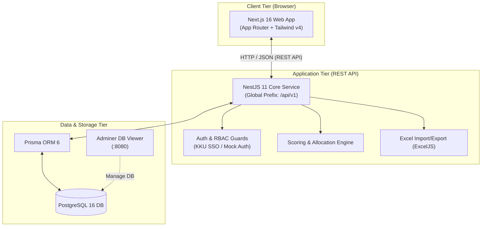

# SEMS-KKU: ระบบบริหารจัดการการประเมินทุนการศึกษา มหาวิทยาลัยขอนแก่น

*Scholarship Evaluation Management System (Khon Kaen University)*

[](https://nextjs.org/)
[](https://nestjs.org/)
[](https://www.postgresql.org/)
[](https://www.prisma.io/)
[](https://tailwindcss.com/)
[](#pdpa-and-security)

> **เว็บแอปพลิเคชันบริหารจัดการการประเมินและการจัดสรรทุนการศึกษา มหาวิทยาลัยขอนแก่น**  
> มุ่งเน้นความโปร่งใส ตรวจสอบย้อนกลับได้ทุกขั้นตอน ลดความซ้ำซ้อนของงานเอกสาร พร้อมระบบคำนวณคะแนนและจัดสรรงบประมาณอัตโนมัติตามกฎทางธุรกิจ ออกแบบตามมาตรฐานวิศวกรรมซอฟต์แวร์ **ISO/IEC 29110**, **ISO/IEC 25010** และสอดคล้องกับ **พระราชบัญญัติคุ้มครองข้อมูลส่วนบุคคล (PDPA)**

---

<a id="table-of-contents"></a>
## 📌 สารบัญ (Table of Contents)

- [ภาพรวมระบบและบทบาทผู้ใช้ (Overview & Roles)](#overview-and-roles)
- [สถาปัตยกรรมระบบ (System Architecture)](#system-architecture)
- [สแตกเทคโนโลยี (Tech Stack)](#tech-stack)
- [โครงสร้างโปรเจกต์ (Repository Structure)](#repository-structure)
- [สารบัญเอกสารการวิเคราะห์และออกแบบ (Documentation Index)](#documentation-index)
- [เริ่มต้นใช้งานในสภาพแวดล้อมจำลอง (Quick Start & Local Setup)](#quick-start-and-local-setup)
- [รายการบริการและบัญชีทดสอบ (Services & Demo Accounts)](#services-and-demo-accounts)
- [คำสั่งควบคุมระบบทั้งหมด (Useful NPM Scripts)](#useful-npm-scripts)
- [กระบวนการทำงานร่วมกันและ Git Workflow (Collaboration & Standards)](#collaboration-and-standards)
- [มาตรการความปลอดภัยและการคุ้มครองข้อมูลส่วนบุคคล (PDPA & Security)](#pdpa-and-security)
- [ผู้รับผิดชอบโครงการและลิขสิทธิ์ (Authors & License)](#authors-and-license)

---

<a id="overview-and-roles"></a>
## 📌 ภาพรวมระบบและบทบาทผู้ใช้ (Overview & Roles)

**SEMS-KKU** พัฒนาขึ้นเพื่อทดแทนระบบการให้คะแนนและจัดสรรทุนการศึกษาเดิมที่พึ่งพาเอกสารกระดาษและสเปรดชีตที่กระจัดกระจาย โดยมีบทบาทหลัก 3 ฝ่าย:

- 🛡️ **ผู้ดูแลระบบ (Admin):**
  - จัดการผู้ใช้งานและกำหนดสิทธิ์ผู้ประเมินรายบุคคล
  - สร้าง/กำหนดรอบทุน เกณฑ์การประเมิน น้ำหนักคะแนน และเกณฑ์ Tie-breaker
  - นำเข้าข้อมูลผู้สมัครจากไฟล์ Excel (.xlsx) และตรวจสอบความถูกต้องเชิงโครงสร้าง
  - ควบคุมสถานะวงจรชีวิตของรอบทุน (`Draft` ➔ `Open` ➔ `In Evaluation` ➔ `Review` ➔ `Allocated` ➔ `Closed`)
  - จำลองและยืนยันผลการจัดสรรทุนตามงบประมาณ พร้อมส่งออกรายงานเข้ารหัส
- ✍️ **ผู้ประเมิน (Evaluator):**
  - เข้าถึงรายชื่อผู้สมัครที่ได้รับมอบหมาย
  - ประเมินและให้คะแนนตามเกณฑ์ย่อย พร้อมระบบบันทึกแบบร่างอัตโนมัติ (Auto-save)
  - ประเมินแบบอิสระโดยไม่เห็นคะแนนของผู้ประเมินท่านอื่น (Blind Review) ก่อนยืนยันผล
- ⚙️ **ระบบอัตโนมัติ (System Automation):**
  - ผสานการยืนยันตัวตนผ่าน KKU Single Sign-On (OAuth2/OIDC)
  - บังคับใช้ Single Active Session (ตัดการเชื่อมต่อหากไม่มีการใช้งานเกิน 60 นาที)
  - คำนวณคะแนนเฉลี่ย, จัดอันดับ และตัดสิทธิ์บัญชีผู้ประเมินชั่วคราวเมื่อสิ้นสุดเวลา
  - บันทึกประวัติการกระทำสำคัญลงใน Audit Log (Append-only) จัดเก็บไม่น้อยกว่า 6 ปี

---

<a id="system-architecture"></a>
## 🏛️ สถาปัตยกรรมระบบ (System Architecture)



---

<a id="tech-stack"></a>
## 🛠️ สแตกเทคโนโลยี (Tech Stack)

| ส่วนของระบบ | เครื่องมือ / ไลบรารี | วัตถุประสงค์การใช้งาน |
| --- | --- | --- |
| **Frontend Framework** | [Next.js 16](https://nextjs.org/) (App Router), React 19, TypeScript | โครงสร้างสถาปัตยกรรมหน้าเว็บแบบ Component-driven และ Responsive Design |
| **Styling & UI** | [Tailwind CSS v4](https://tailwindcss.com/), Lucide Icons | ระบบดีไซน์ Dual-View (Table บน Desktop และ Cards บน Mobile) ตาม Apple HIG |
| **Backend Framework** | [NestJS 11](https://nestjs.org/), Express, TypeScript | สถาปัตยกรรม REST API แบบ Modular ออกแบบ Validation, Filter, Guard เป็นระบบ |
| **Database & ORM** | [PostgreSQL 16](https://www.postgresql.org/), [Prisma ORM 6](https://www.prisma.io/) | การจัดเก็บข้อมูลที่มีโครงสร้างซับซ้อน รองรับ ACID Transactions และ Migration |
| **Authentication** | KKU SSO (OIDC/OAuth2) & Mock Guard | เข้าสู่ระบบด้วยบัญชีองค์กร (`@kku.ac.th`, `@kkumail.com`) |
| **Spreadsheet Engine** | [ExcelJS](https://github.com/exceljs/exceljs) | ตรวจสอบ Data Type และนำเข้า/ส่งออกไฟล์ Excel ผู้สมัครและผลคะแนน |
| **Testing** | Jest, Supertest (Backend) & Vitest, Testing Library (Frontend) | ทดสอบ Unit, Integration และ E2E มั่นใจในคุณภาพโค้ด |
| **Container & CI/CD** | Docker Compose, GitHub Actions | สภาพแวดล้อมการพัฒนาที่เหมือนกันทั้งทีม และ Pipeline ตรวจสอบอัตโนมัติ |

---

<a id="repository-structure"></a>
## 📁 โครงสร้างโปรเจกต์ (Repository Structure)

โปรเจกต์ได้รับการจัดโครงสร้างเป็นแบบ **NPM Monorepo Workspaces**:

```text
SEMS-KKU/
├── backend/                 # ฝั่งบริการ REST API Server (NestJS 11)
│   ├── prisma/              # Prisma Schema, Migrations และ Seed Scripts
│   ├── src/                 # โมดูลระบบ (Controllers, Services, DTOs, Guards)
│   ├── test/                # Unit Tests และ End-to-End Tests
│   └── package.json
│
├── frontend/                # ฝั่งส่วนติดต่อผู้ใช้ (Next.js 16 App Router)
│   ├── src/
│   │   ├── app/             # Application Routes แยกตามกลุ่มผู้ใช้งาน
│   │   ├── components/      # Reusable UI Components
│   │   └── lib/             # API Client, State Helpers, Utilities
│   └── package.json
│
├── docs/                    # คลังเอกสารข้อกำหนดและการออกแบบระบบฉบับเต็ม
│   ├── 00-project/          # ขอบเขตโครงการ (Scope 1.3) และวัตถุประสงค์
│   ├── 01-planning/         # Traceability Matrix (ISO/IEC 29110)
│   ├── 02-requirements/     # ข้อกำหนด FRS (127 ข้อ), NFR (50 ข้อ), Business Rules (127 ข้อ)
│   ├── 03-architecture/     # สถาปัตยกรรมระบบ, ERD (14 ตาราง), Data Dictionary, Tech Stack
│   ├── 04-development/      # สคีมาต้นแบบ Prisma Schema และไกด์การพัฒนา
│   ├── 05-design/           # Design System และหน้าจอต้นแบบ UI Wireframes (50+ จอ)
│   └── 06-data/             # แม่แบบและข้อมูลตัวอย่างการนำเข้า (Excel, CSV, JSON)
│
├── .github/                 # GitHub Workflows (CI/CD Pipeline) และ Issue/PR Templates
├── docker-compose.yml       # คอนฟิกฐานข้อมูล Local (PostgreSQL 16 + Adminer)
├── docker-compose.prod.yml  # คอนฟิกสำหรับ Production Deployment
├── .env.example             # แม่แบบตัวแปรสภาพแวดล้อม (Environment Variables)
├── package.json             # Root Workspace Configuration และ Scripts รวม
└── README.md
```

---

<a id="documentation-index"></a>
## 📚 สารบัญเอกสารการวิเคราะห์และออกแบบ (Documentation Index)

เอกสารข้อกำหนดทางวิศวกรรมซอฟต์แวร์ทั้งหมดถูกรวบรวมอย่างเป็นระบบในไดเรกทอรี [`docs/`](docs/README.md):

- **[ขอบเขตและภาพรวมระบบ (Scope 1.3)](docs/00-project/sems-scope.md):** ขอบเขตการทำงาน บทบาทผู้ใช้งาน และกระบวนการทำงานหลัก
- **[ตารางความครอบคลุม (Traceability Matrix)](docs/01-planning/sems-traceability-matrix.md):** แผนผังตรวจสอบความสอดคล้องระหว่าง BR, FRS, NFR และ Use Case
- **[กฎทางธุรกิจ (Business Rules 127 ข้อ)](docs/02-requirements/sems-business-rules.md):** กฎเกณฑ์ 14 หมวดหมู่ ครอบคลุมการคำนวณและจัดสรรทุน
- **[ข้อกำหนดฟังก์ชัน (FRS 127 ข้อ)](docs/02-requirements/sems-functional-requirements.md):** ข้อกำหนดความต้องการเชิงหน้าที่ตามมาตรฐาน ISO/IEC 29110
- **[ข้อกำหนดคุณภาพ (NFR 50 ข้อ)](docs/02-requirements/sems-non-functional-requirements.md):** ข้อกำหนดประสิทธิภาพ ความปลอดภัย และความพร้อมใช้งาน (ISO/IEC 25010)
- **[รายละเอียดกรณีใช้งาน (Use Case 23 เคส)](docs/02-requirements/sems-usecase-description.md):** คำอธิบายขั้นตอนและทางเลือกการทำงานของผู้ใช้
- **[ผังขั้นตอนการใช้งาน (User Flow)](docs/02-requirements/sems-user-flow.md):** ผังงานแสดงเส้นทางการใช้งานของ Admin และ Evaluator
- **[สถาปัตยกรรมและเทคโนโลยี (Architecture)](docs/03-architecture/sems-tech-stack.md):** มาตรฐานโครงสร้างระบบและการรักษาความปลอดภัย
- **[แผนภาพฐานข้อมูล ERD (14 ตาราง)](docs/03-architecture/sems-schema-description.md):** พจนานุกรมข้อมูลและความสัมพันธ์ของเอนทิตีทั้งหมด
- **[โมเดล Prisma (Prisma Schema)](docs/04-development/sems-schema.prisma):** สคีมาฐานข้อมูลสำหรับการสร้างตารางจริง
- **[หน้าจอต้นแบบ (UI Wireframes 50+ หน้าจอ)](docs/05-design/sems-wireframe/):** ต้นแบบ Interactive UI และ Design System
- **[แม่แบบไฟล์ข้อมูล (Import Templates)](docs/06-data/README.md):** ไฟล์ตัวอย่างสำหรับทดสอบการนำเข้าข้อมูลผู้สมัคร

---

<a id="quick-start-and-local-setup"></a>
## 🚀 เริ่มต้นใช้งานในสภาพแวดล้อมจำลอง (Quick Start & Local Setup)

ปฏิบัติตาม 5 ขั้นตอนด้านล่างนี้เพื่อเปิดระบบในเครื่องของท่าน:

### 1. เครื่องมือจำเป็นก่อนเริ่ม (Prerequisites)

- [Node.js](https://nodejs.org/) (เวอร์ชัน 20 LTS ขึ้นไป หรือเวอร์ชัน 22)
- [Docker Desktop](https://www.docker.com/) พร้อมเปิดใช้งาน Docker Compose
- [Git](https://git-scm.com/)

---

### 2. โคลน Repository

```bash
git clone https://github.com/warattapobwaiarsa/SEMS-KKU.git
cd SEMS-KKU
```

---

### 3. คัดลอกและตั้งค่า Environment Variables

คัดลอกไฟล์ `.env.example` เพื่อสร้างไฟล์ `.env` ที่ Root Directory:

```bash
# บน Linux/macOS
cp .env.example .env

# บน Windows PowerShell
copy .env.example .env
```

*(ค่ามาตรฐานใน `.env.example` ถูกตั้งไว้ให้พร้อมใช้งานกับ Docker และ Localhost ได้ทันที)*

---

### 4. ติดตั้ง Dependencies และเริ่มต้นฐานข้อมูล

```bash
# 4.1 ติดตั้ง Packages ทั้งระบบ (Frontend + Backend)
npm install

# 4.2 เริ่มต้นบริการ PostgreSQL และ Adminer ผ่าน Docker
docker compose up -d

# 4.3 สร้าง Database Schema และ Client ด้วย Prisma
npm run prisma:generate
npm run prisma:migrate

# 4.4 นำเข้าข้อมูลเริ่มต้นสำหรับทดสอบ (Seed Initial Users)
npm run prisma:seed
```

---

### 5. รันระบบสำหรับการพัฒนา (Local Development)

สามารถเลือกวิธีรันระบบได้ 2 วิธีตามความสะดวก:

#### วิธีที่ 1: รันพร้อมกันทุกบริการในหน้าต่างเดียว (แนะนำ)

```bash
npm run dev
```

*(คำสั่งนี้จะสั่งรัน Backend ที่พอร์ต 4000 และ Frontend ที่พอร์ต 3000 พร้อมกันด้วย `concurrently`)*

#### วิธีที่ 2: รันแยก Terminal

```bash
# Terminal 1: รัน Backend REST API
npm run dev:backend

# Terminal 2: รัน Frontend Web App
npm run dev:frontend
```

---

<a id="services-and-demo-accounts"></a>
## 🌐 รายการบริการและบัญชีทดสอบ (Services & Demo Accounts)

เมื่อระบบทำงานสมบูรณ์ ท่านสามารถเข้าถึงบริการต่าง ๆ ได้ตามที่อยู่นี้:

| บริการ | URL เข้าใช้งาน | รายละเอียด |
| --- | --- | --- |
| **Frontend Web App** | [http://localhost:3000](http://localhost:3000) | หน้าเว็บหลักของระบบ (Next.js) |
| **Backend REST API** | [http://localhost:4000/api/v1](http://localhost:4000/api/v1) | Endpoint หลักของ API (NestJS) |
| **Adminer (Database GUI)** | [http://localhost:8080](http://localhost:8080) | เครื่องมือจัดการฐานข้อมูล PostgreSQL ผ่าน Browser |

> **การล็อกอินเข้า Adminer:**
>
> - **System:** `PostgreSQL`
> - **Server:** `postgres` (หรือ `localhost` หากเชื่อมจากนอก Docker network)
> - **Username:** `sems_user`
> - **Password:** `sems_password`
> - **Database:** `sems_db`

### 🔑 บัญชีผู้ใช้งานเริ่มต้นสำหรับการทดสอบ (Seeded Accounts)

ข้อมูลบัญชีที่ได้จากการรัน `npm run prisma:seed`:

| บทบาท (Role) | อีเมล (Email) | ชื่อ-นามสกุล | สิทธิ์การเข้าถึง |
| --- | --- | --- | --- |
| **Admin** | `admin@kku.ac.th` | ผู้ดูแลระบบ ทุนการศึกษา | จัดการข้อมูลรอบทุน, นำเข้าผู้สมัคร, จัดสรรงบประมาณ |
| **Evaluator** | `evaluator1@kku.ac.th` | ศ.ดร. สุรชัย ใจมั่น | ประเมินและบันทึกคะแนนผู้สมัคร |
| **Evaluator** | `evaluator2@kku.ac.th` | ผศ.ดร. วิภาดา เกียรติสกุล | ประเมินและบันทึกคะแนนผู้สมัคร |
| **Evaluator** | `evaluator3@kku.ac.th` | รศ.ดร. นพดล เจริญพร | ประเมินและบันทึกคะแนนผู้สมัคร |

---

<a id="useful-npm-scripts"></a>
## ⚡ คำสั่งควบคุมระบบทั้งหมด (Useful NPM Scripts)

| คำสั่ง | คำอธิบายการทำงาน |
| --- | --- |
| `npm run dev` | รันทั้ง Frontend และ Backend พร้อมกันในโหมด Development |
| `npm run dev:backend` | รันเฉพาะ NestJS REST API Server |
| `npm run dev:frontend` | รันเฉพาะ Next.js Web App |
| `npm run build` | บิลด์โค้ดสำหรับเตรียมขึ้น Production ทั้งสองฝั่ง |
| `npm run lint` | ตรวจสอบ Code Style และ ESLint กฎระเบียบทั้งระบบ |
| `npm run test` | รัน Unit Tests ฝั่ง Backend |
| `npm run test:backend` | รัน Unit Tests ฝั่ง Backend ผ่าน Jest |
| `npm run test:frontend` | รัน Tests ฝั่ง Frontend ผ่าน Vitest |
| `npm run test:all` | รัน Tests ทั้งหมดในระบบ |
| `npm run prisma:generate` | สร้าง Prisma Client สำหรับ TypeScript |
| `npm run prisma:migrate` | นำ Schema ล่าสุดไปอัปเดตลงในฐานข้อมูล PostgreSQL |
| `npm run prisma:seed` | นำข้อมูลทดสอบตั้งต้นลงในฐานข้อมูล |

---

<a id="collaboration-and-standards"></a>
## 🌿 กระบวนการทำงานร่วมกันและ Git Workflow (Collaboration & Standards)

### 1. นโยบายการแตกกิ่งสาขา (Branching Strategy)

- **`main`**: กิ่งสำหรับเวอร์ชัน Production (ล็อกไม่ให้ push ตรง)
- **`develop`**: กิ่งรวมสำหรับรวมการพัฒนาฟังก์ชันในรอบ Sprint
- **`feature/<FR-ID>-<ชื่อย่อฟีเจอร์>`**: แตกกิ่งออกจาก `develop` เพื่อพัฒนาฟังก์ชันตามรหัส FRS
  - ตัวอย่าง: `feature/FR-RND-01-round-management`
  - ตัวอย่าง: `feature/FR-EVL-04-evaluation-form`
- **`bugfix/<issue-id>-<ชื่อการแก้ไข>`**: แตกกิ่งออกจาก `develop` เพื่อแก้บั๊ก

### 2. รูปแบบข้อความบันทึกการส่งโค้ด (Conventional Commits)

ต้องระบุชนิดการแก้ไขและอ้างอิงรหัสความต้องการ (Requirement ID) เสมอ:

- `feat(round): implement round status transition [FR-RND-04]`
- `fix(criteria): enforce 100-point total validation [BR-CRT-04]`
- `test(evaluation): add test for peer-blind score calculation [BR-SCR-01]`
- `docs(readme): update setup and architecture documentation`

### 3. นโยบายการตรวจสอบก่อนรวมโค้ด (Pull Request Policy)

- ต้องเปิด PR เข้าสู่กิ่ง `develop` เท่านั้น
- ต้องผ่านการตรวจสอบโค้ดจากสมาชิกในทีม (Peer Code Review) อย่างน้อย **1 คน**
- ต้องผ่านการทดสอบอัตโนมัติใน GitHub Actions CI (Typecheck, Lint, Tests, Prisma Check) 100%

---

<a id="pdpa-and-security"></a>
## 🔒 มาตรการความปลอดภัยและการคุ้มครองข้อมูลส่วนบุคคล (PDPA & Security)

> [!CAUTION]
> **การรักษาความปลอดภัยของข้อมูลสำคัญ:**
>
> - **ห้ามนำไฟล์ `.env` หรือ Credential จริงขึ้น Git เด็ดขาด** ทุกตัวแปรลับต้องส่งผ่าน Environment Variables หรือ Secret Manager เท่านั้น
> - **ห้ามใช้ข้อมูลจริงของนักศึกษาในการทดสอบ:** ต้องใช้ไฟล์ตัวอย่างจำลองจากโฟลเดอร์ `docs/06-data/` เท่านั้น

1. **การเข้ารหัสข้อมูลระบุตัวตน (Citizen ID Encryption):** เลขประจำตัวประชาชนของผู้สมัครจะถูกเข้ารหัสด้วย **AES-256-GCM** ก่อนบันทึกลงฐานข้อมูล และจะต้องแสดงผลในรูปแบบปิดบัง (Data Masking เช่น `1-2345-XXXXX-XX-3`) ในทุกหน้าจอ
2. **การบันทึกประวัติกิจกรรมที่ไม่สามารถแก้ไขได้ (Append-only Audit Trail):** การกระทำของผู้ดูแลระบบ เช่น การเปลี่ยนแปลงสถานะรอบทุน, การแก้ไขเกณฑ์, การจัดสรรงบประมาณ และการดาวน์โหลดรายงาน จะถูกบันทึกประวัติการกระทำและจัดเก็บไว้ไม่น้อยกว่า **6 ปี** ตามข้อกำหนดกฎหมาย
3. **การประเมินแบบอิสระ (Blind Evaluation):** ผู้ประเมินจะไม่เห็นคะแนนหรือความคิดเห็นของกรรมการท่านอื่น จนกว่ากระบวนการประเมินจะเสร็จสิ้นสมบูรณ์ เพื่อความโปร่งใสและเป็นกลางสูงสุด

---

<a id="authors-and-license"></a>
## 👥 ผู้รับผิดชอบโครงการและลิขสิทธิ์ (Authors & License)

- **พัฒนาโดย:** ทีมพัฒนาระบบบริหารจัดการทุนการศึกษา มหาวิทยาลัยขอนแก่น (SEMS-KKU)
- **ลิขสิทธิ์:** พัฒนาเพื่อการใช้งานภายในมหาวิทยาลัยขอนแก่น (Internal / Proprietary Software)
