# SEMS User Flow

เส้นทางการใช้งานของระบบบริหารจัดการการประเมินทุนการศึกษา สรุปจาก Scope, Use Case, Business Rule (v1.2) และ Functional Requirement (v0.1) ทุกกล่องเงื่อนไขอ้างอิงกฎและข้อความ MSG ตามเอกสาร

17 flowAdmin 11Evaluator 3ทั่วไป/ระบบ 3ฉบับร่าง 3 ต.ค. 2569

[ภาพรวม](#g-overview) [เข้า/ออกระบบ](#g-common) [Admin](#g-admin) [Evaluator](#g-eval) [ระบบอัตโนมัติ](#g-sys) [ข้อสังเกต](#g-notes)

## ภาพรวมวงจรรอบทุน

ทุก flow ในเอกสารนี้ต่อกันเป็นเส้นเดียวนี้ รอบทุนมีสถานะ Draft, Open, Closed ส่วนผลจัดสรรมีสถานะ Editing, Finalized แยกจากกัน

G0

### วงจรรอบทุนตั้งแต่สร้างจนส่งออกรายงาน

ข้ามบทบาท

S 1.3.2.3–1.3.2.12 · BR-RND-04 · BR-ALC-11

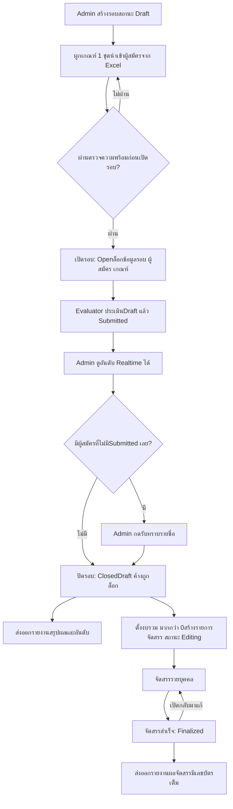

### สิ่งที่ทำได้ในแต่ละสถานะรอบ

สรุปจาก BR-RND, BR-IMP, BR-EVL, BR-ALC, BR-EXP

| การกระทำ | Draft | Open | Closed |
| --- | --- | --- | --- |
| แก้ข้อมูลหลักของรอบ | ได้ | ไม่ได้ | ไม่ได้ |
| เลือก/เปลี่ยน/ถอดเกณฑ์ของรอบ | ได้ | ไม่ได้ | ไม่ได้ |
| นำเข้า/แทนที่ผู้สมัคร | ได้ | ไม่ได้ | ไม่ได้ |
| Admin ดูรายชื่อผู้สมัคร | ได้ | ได้ | ได้ |
| Evaluator เห็นผู้สมัครและประเมิน | ไม่ได้ | ได้ | ไม่ได้ (Draft ถูกล็อก) |
| Admin ดูผลประเมินและอันดับ | ยังไม่มีผล | ได้ (Realtime) | ได้ |
| ตั้งงบรวมและจัดสรรทุน | ไม่ได้ | ไม่ได้ | ได้ |
| ส่งออกรายงานสรุปผล | ไม่ได้ | ไม่ได้ | ได้ |
| ส่งออกรายงานจัดสรร | ไม่ได้ | ไม่ได้ | ได้ เมื่อ Finalized |

## เข้าและออกจากระบบ

ใช้ร่วมกันทั้งสองบทบาท เข้าสู่ระบบผ่าน KKU SSO เท่านั้น

C1

### เข้าสู่ระบบ ใช้งาน และออกจากระบบ

Admin และ Evaluator

UC-01, UC-02, UC-03 · FR-AUTH-01–07 · BR-USR-01, BR-EVL-08, BR-SYS-02 · MSG-01, MSG-28

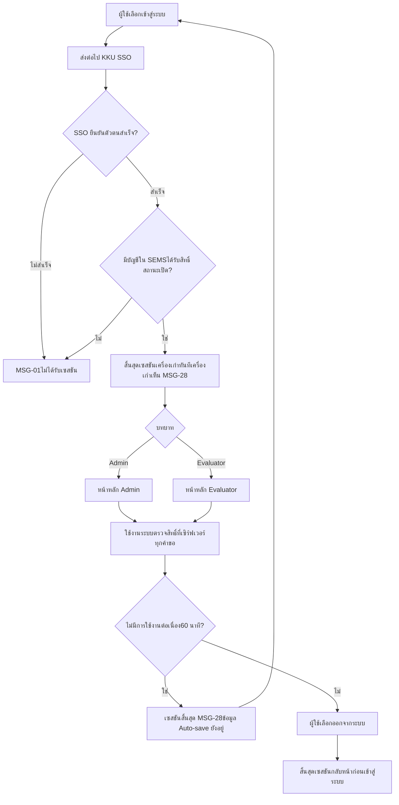

## Admin

11 flow ตามลำดับที่ใช้งานจริงในหนึ่งรอบทุน

A1

### จัดการผู้ใช้และสถานะบัญชี

Admin

UC-A01 · FR-USR-01–15 · BR-USR-02–15 · MSG-02, 03, 04, 29, 30

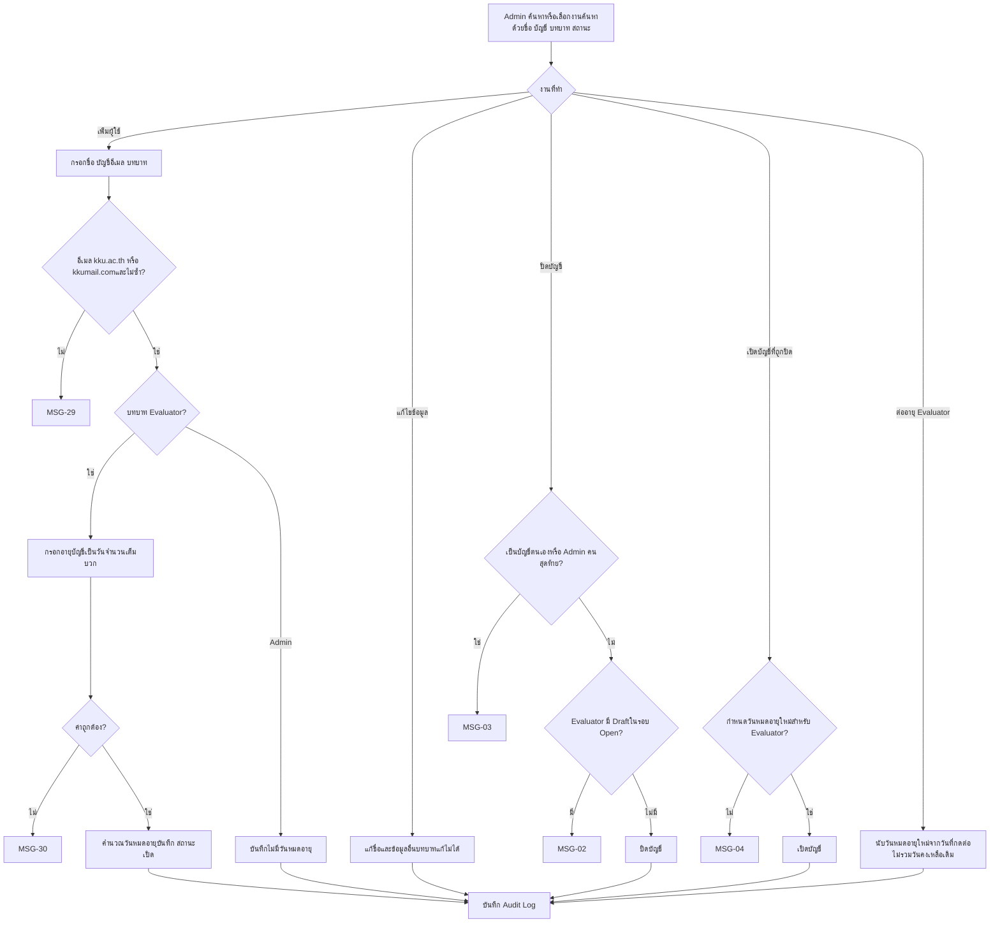

ไม่มีฟังก์ชันลบผู้ใช้ ปิดการใช้งานได้อย่างเดียว

A2

### จัดการรอบทุนการศึกษา

Admin

UC-A02 · FR-RND-01–06 · BR-RND-01–06, 14 · MSG-27, 33

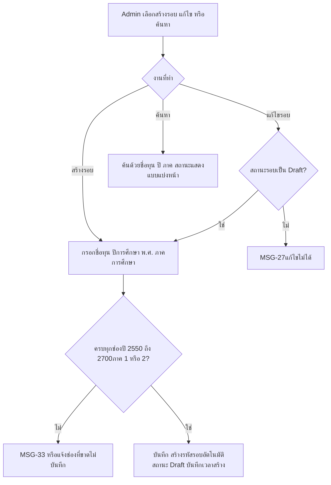

ชื่อทุน ปี ภาคซ้ำกันได้ ไม่มีฟังก์ชันลบรอบ

A3

### สร้างเกณฑ์ประเมินและเชื่อมกับรอบ

Admin

UC-A03 · FR-CRT-01–13, FR-RND-07 · BR-CRT-01–12 · MSG-06, 07, 08, 09, 31

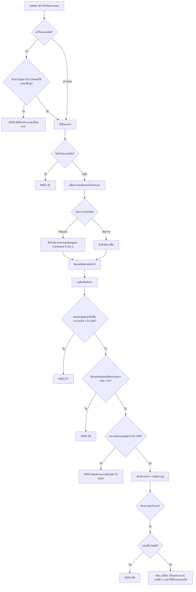

A4

### นำเข้าผู้สมัครจากไฟล์ Excel

Admin

UC-A04, UC-A05 · FR-IMP-01–17 · BR-IMP-01–23 · MSG-11, 12, 13, 14, 27, 32

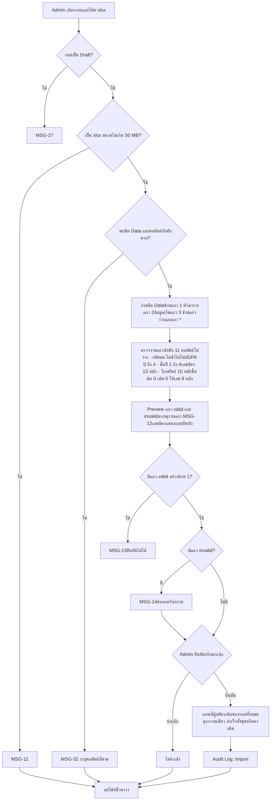

แถว invalid ไม่ถูกนำเข้า และผู้สมัครที่นำเข้าแล้วแก้ใน SEMS ไม่ได้ ต้องแก้ที่ระบบเดิมแล้วนำเข้าใหม่ (เฉพาะรอบ Draft)

A5

### ดูรายชื่อผู้สมัครในรอบ

Admin

UC-A06 · FR-APP-01–02 · BR-APP-01–03

A6

### เปิดรอบทุน

Admin

UC-A07 · FR-RND-08–11 · BR-RND-08–11 · MSG-10

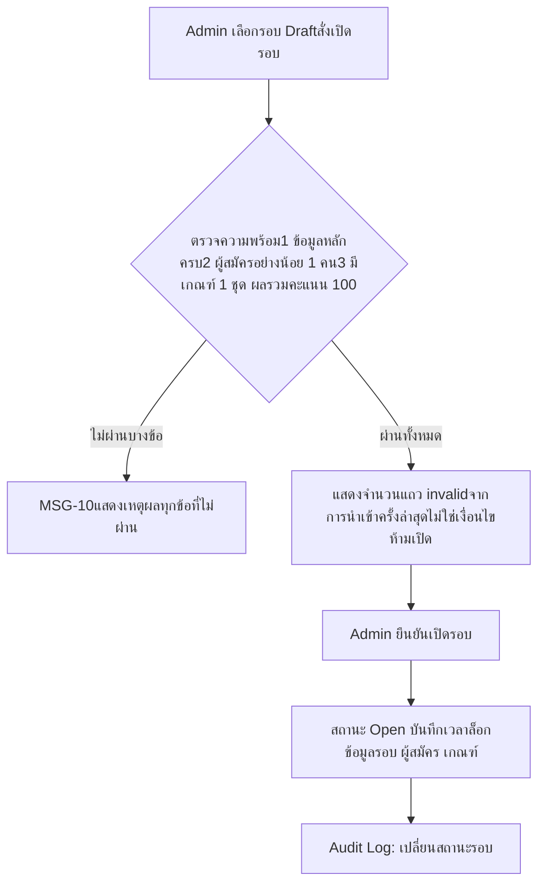

เปิด Open พร้อมกันหลายรอบได้ Evaluator เห็นผู้สมัครของทุกรอบที่ Open

A7

### ปิดรอบทุน

Admin

UC-A07 · FR-RND-12–13, FR-AUD-03 · BR-RND-12–13, BR-EVL-13 · MSG-19, MSG-20

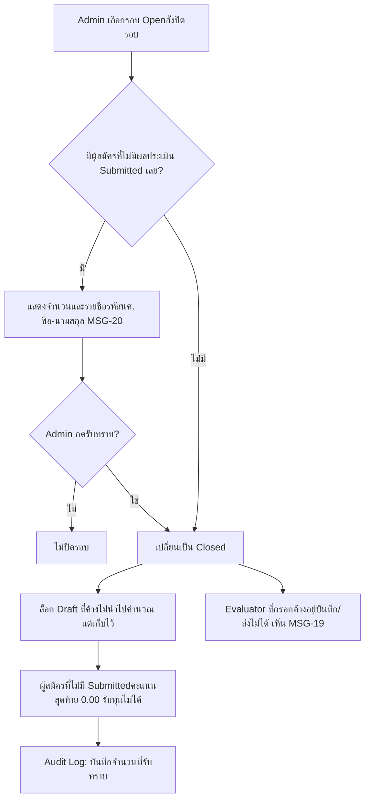

A8

### ดูผลการประเมินและอันดับ

AdminRealtime ระหว่าง Open ยังไม่อยู่ใน Scope

UC-A08 · FR-SCR-01–06 · BR-SCR-01–06

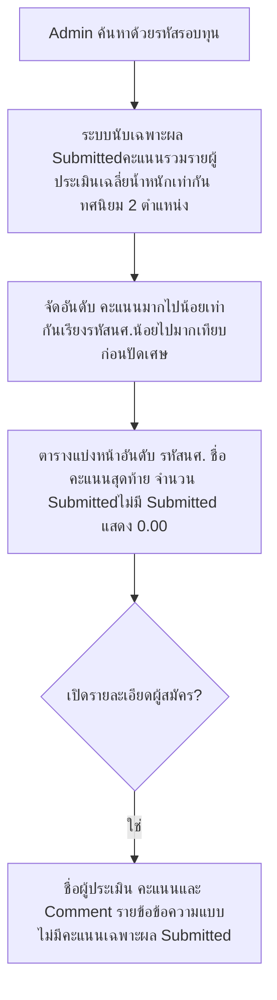

A9

### กำหนดงบและจัดสรรทุนรายบุคคล

Admin

UC-A09, UC-A10 · FR-ALC-01–10, 14 · BR-ALC-01–10, BR-PDP-03–05 · MSG-21–27

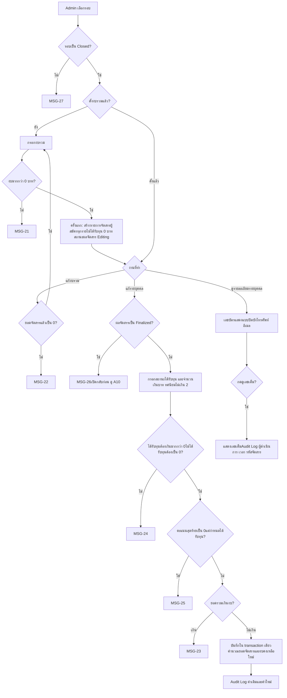

ระบบไม่ตัดสินผู้ได้รับทุนแทน Admin และไม่บังคับจัดสรรตามลำดับคะแนน

A10

### ยืนยันผลจัดสรร และเปิดกลับมาแก้ไข

Admin

UC-A11, UC-A12, UC-A13 · FR-ALC-11–13 · BR-ALC-11–13 · MSG-26, MSG-27

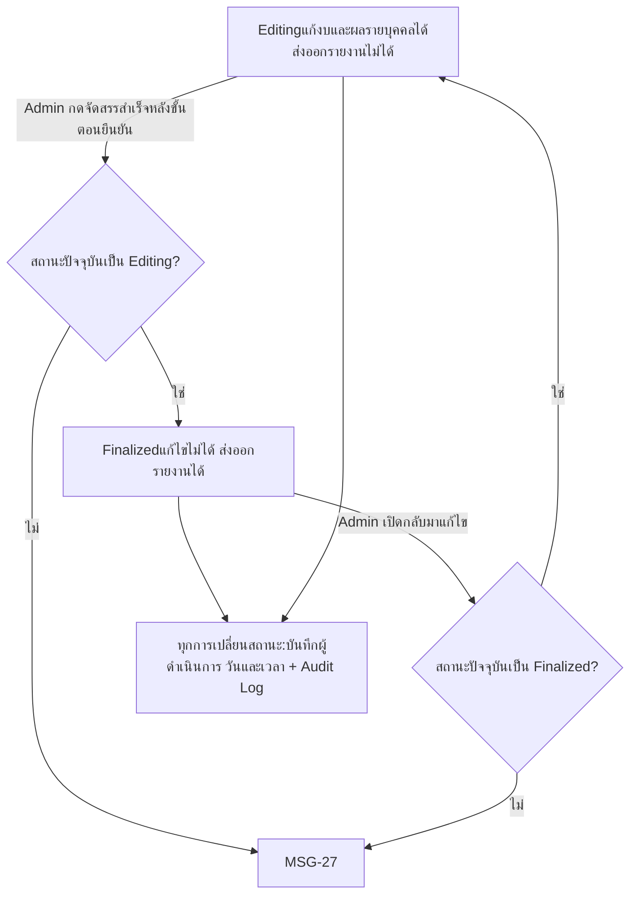

สถานะผลจัดสรรแยกจากสถานะรอบทุน การแก้ซ้ำหลังเปิดกลับยังบันทึกค่าเดิมและค่าใหม่ทุกครั้ง

A11

### ส่งออกรายงาน Excel

Admin

UC-A14, UC-A15 · FR-EXP-01–09 · BR-EXP-01–08 · MSG-27

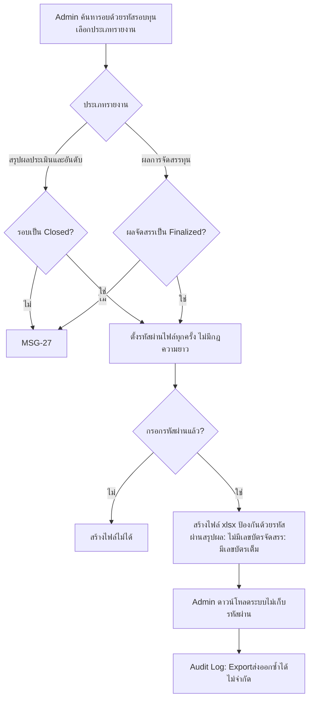

## Evaluator

ผู้ประเมินเห็นผู้สมัครของทุกรอบที่ Open ไม่มีการมอบหมายรายบุคคล และไม่เห็นเลขบัตร โทรศัพท์ อีเมล

E1

### ค้นหาและเลือกผู้สมัคร

Evaluator

UC-E01, UC-E02 · FR-EVL-01–03, FR-APP-03–05, FR-USR-14 · BR-EVL-01–02, BR-USR-11 · MSG-17, MSG-18

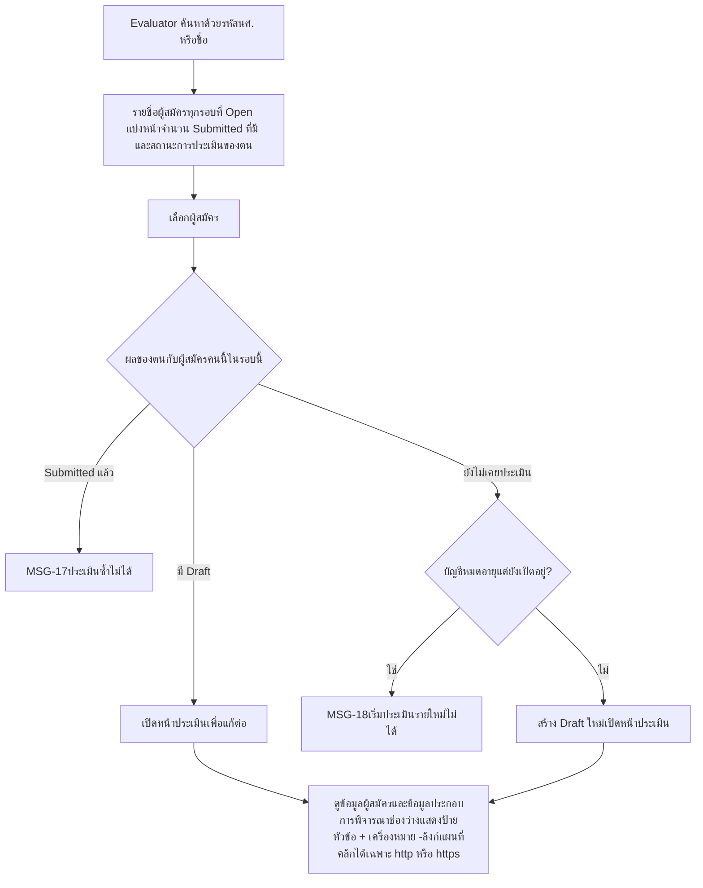

Evaluator หลายคนประเมินผู้สมัครคนเดียวกันได้ไม่จำกัดจำนวน

E2

### กรอกคะแนน ตรวจสรุป และส่งผลประเมิน

Evaluator

UC-E03, UC-E04, UC-E05 · FR-EVL-04–13, 15 · BR-EVL-03–14 · MSG-15, 16, 19, 28

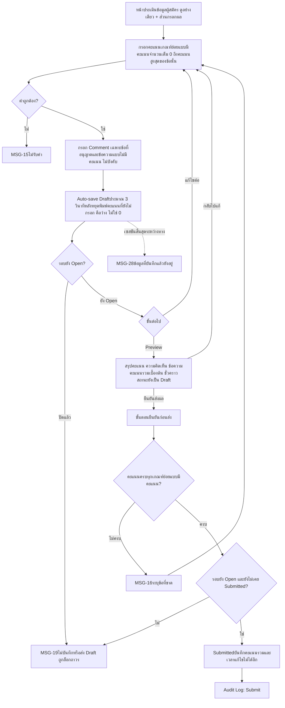

Admin ส่งผลแทน Evaluator หรือแก้ผลที่ Submitted แล้วไม่ได้

E3

### ดูผลการประเมินของตนเอง

Evaluatorใหม่ ยังไม่มีใน Scope และ UC

FR-EVL-14 · คำตัดสิน E8

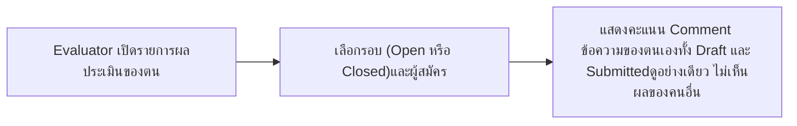

ต้องเพิ่ม UC-E06 และแก้ Scope 1.3.3 ก่อนใช้ flow นี้ ดูข้อสังเกตข้อ 1

## ระบบอัตโนมัติ

ทำงานเองโดยไม่มีผู้ใช้สั่ง

S1

### ตัดวันหมดอายุบัญชี Evaluator

ระบบ

FR-USR-12–13 · BR-USR-06, 10, 11, BR-SYS-03 · NFR-AVL-03 · MSG-01, MSG-18

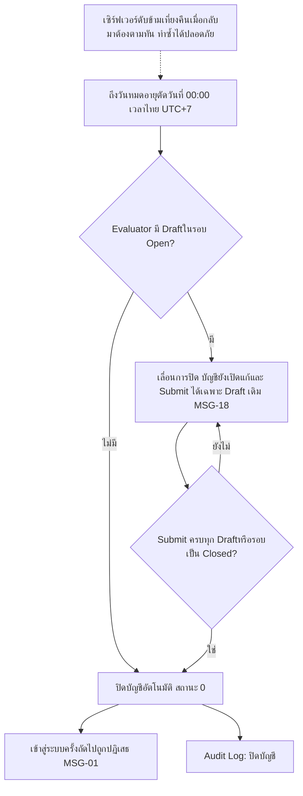

## ข้อสังเกตที่พบระหว่างเขียน flow

จุดที่เอกสารต้นทางยังไม่ตรงกันหรือยังไม่ครบ ควรตัดสินก่อนออกแบบหน้าจอ

- **E3 ขัดกับกฎเห็นเฉพาะรอบ Open** FR-EVL-14 ให้ Evaluator ดูผลของตนในรอบ Closed ด้วย แต่ BR-EVL-01 ให้เห็นผู้สมัครเฉพาะรอบ Open ต้องตัดสินว่าหน้า "ผลของฉัน" เป็นหน้าแยกที่ไม่ผูกกับรายชื่อผู้สมัคร
- **Draft ที่ถูกล็อกหลังปิดรอบ** เอกสารไม่ระบุว่า Evaluator เห็น Draft ที่ถูกล็อกหรือไม่ นอกจากข้อความ MSG-19 ขณะกรอก
- **Admin ปิดรอบขณะ Evaluator กรอกอยู่** flow A7 และ E2 เขียนตาม FR-EVL-13 แต่ UC-E03 ยังไม่มี Alternative รองรับ
- **ค่า "ลำดับ" จากระบบเดิม** เก็บไว้และแสดงให้ Evaluator แต่ FR-APP-02 ไม่ให้ Admin เห็นในตารางรายชื่อ ต้องยืนยันว่า Admin เห็นหรือไม่
- **Realtime ระหว่างรอบ Open** (A8) Scope ไม่ได้ระบุสถานะรอบที่ดูผลได้ และ NFR-PRF-03 ยังไม่มีเป้าความเร็ว
- **ขั้นตอนยืนยัน** NFR-USB-05 ให้มี dialog ยืนยันก่อนเปิดรอบ ปิดรอบ ส่งผล Finalized ผมใส่ไว้เฉพาะ E2 และ A10 ส่วน A6, A7 ถือว่ามีในจังหวะ "ยืนยันเปิด" และ "กดรับทราบ"

สร้างจากเอกสารใน Project UserFlow ฉบับร่าง ควรตรวจกับ Scope ฉบับจริงก่อนส่งอาจารย์