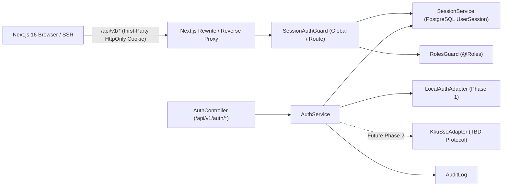

# AUTH_ARCHITECTURE.md — SSO-Ready Authentication & Authorization Architecture

> **Status:** Architecture Design Only (Read-Only Mission 02 — No Source Code Modified)  
> **Target System:** SEMS-KKU (Next.js 16 + NestJS 11 + Express + Prisma 6 + PostgreSQL 16)  
> **Scope:** Authentication Core, Identity Provider Boundary, Session Security, Frontend Auth, Production Deployment

---

## 1. Verified Findings (ตรวจสอบจาก Source Code ปัจจุบัน)

1. **Authentication Guards (`backend/src/common/guards/`):**
   - `MockAuthGuard` (`mock-auth.guard.ts`) และ `RoleDispatchGuard` (`role-dispatch.guard.ts`) อ่านตัวตนผู้ใช้จาก HTTP Header `x-user-id` (`X-User-Id`) แล้วค้นหา `User` จาก PostgreSQL ผ่าน `PrismaService`
   - ทั้งสอง Guard ตรวจสอบ `user.isActive` (ตอบ `401 ACCOUNT_DEACTIVATED` หาก `false`) และแนบ `request.user = user`
   - ทั้งสอง Guard **ไม่ได้ตรวจสอบ `user.expiresAt`** และ **ไม่ได้ใช้งาน Model `UserSession`**
   - ทั้งสอง Guard มีการป้องกัน Production: หาก `process.env.NODE_ENV === 'production'` และ `process.env.ALLOW_MOCK_AUTH !== 'true'` จะโยน `403 Forbidden (MOCK_AUTH_PROHIBITED_IN_PRODUCTION)`
2. **Authorization Bypass & Role Header Fallbacks:**
   - `CriteriaController.findOne` (`backend/src/criteria/criteria.controller.ts:39-48`) ใช้ `@UseGuards(RoleDispatchGuard)` ซึ่งตั้งค่า `request.resolvedRole` จาก DB แล้ว **แต่ไม่นำไปใช้** กลับอ่าน `@Headers('x-user-role')` และ `@Query('userRole')` ส่งเข้า `criteriaService.findOne(id, userRole)`
   - `RoundsController` (`findAll`, `findOne`) และ `ApplicantsController` (`findAll`, `findOne`, `getTravelDistance`) ยังคงมี fallback `resolvedRole || roleHeader || roleQuery`
   - `ScholarshipTypesController` (`GET /api/v1/scholarship-types` และ `GET /api/v1/scholarship-types/:id`) **ไม่มี `@UseGuards(...)`**
   - `CriteriaController.findAll` ใช้ `RoleDispatchGuard` โดยไม่มี `@Roles(...)` และไม่กรองผลตามบทบาท
3. **Unused Session Model (`backend/prisma/schema.prisma:81-89`):**
   - มี `model UserSession` (`id`, `userId @unique`, `sessionId @unique`, `createdAt`, `lastActivityAt`) อยู่แล้ว แต่ไม่มี Service หรือ Guard ใดเรียกใช้งาน
4. **Frontend Auth State & API Client:**
   - `frontend/src/lib/mock-evaluator.ts` เก็บ `sems_mock_evaluator_id` (default `'2'`) และ `sems_mock_admin_id` (default `'1'`) ใน `localStorage`
   - `frontend/src/lib/api-client.ts` ดึง ID จาก `mock-evaluator.ts` แล้วฉีด Header `X-User-Id` อัตโนมัติ (และลบ `X-User-Role`)
   - `frontend/src/app/(admin)/admin/layout.tsx` และ `(evaluator)/evaluator/layout.tsx` render Shell โดยไม่มีการตรวจสอบ Session ฝั่ง Server หรือ Redirect
   - `frontend/src/services/allocation.service.ts` (`fetchAllocationSummary`) กลืน Error ใน `catch` แล้วคืน `{ success: true, data: ... }` (ข้อมูลว่างปลอม)
   - `frontend/src/services/reports.service.ts` สร้างไฟล์ `.xlsx` จำลองฝั่ง Client เมื่อเรียก Backend ไม่สำเร็จ (และยังไม่มี Reports Module ใน `backend/src/`)
5. **Same-Origin Proxy & Production Config:**
   - `frontend/next.config.ts` ตั้งค่า `rewrites()` ส่ง `/api/v1/:path*` ไปยัง `${BACKEND_INTERNAL_URL || "http://localhost:4000"}/api/v1/:path*`
   - `docker-compose.prod.yml` กำหนด `NODE_ENV: production` และ `ALLOW_MOCK_AUTH: "false"` ทำให้ทุก Endpoint ที่ใช้ `MockAuthGuard` / `RoleDispatchGuard` ปฏิเสธคำขอด้วย `403`

---

## 2. Proposed Design

### 2.1 High-Level Architecture & Identity Provider Boundary

แยก **Authentication Core** ออกจาก **Identity Provider (IdP)** ผ่าน `IdentityProviderAdapter` interface เพื่อให้ระบบทำงานได้จริงด้วย **Local Authentication** ในระยะแรก และเชื่อมต่อ **KKU SSO** ในอนาคตได้โดยไม่แก้ Session Core, Guards, หรือ Controllers

### 2.2 Backend Authentication Core (`AuthModule`)

1. **`AuthModule`** (ลงทะเบียนใน `AppModule`):
   - `AuthController`:
     - `POST /api/v1/auth/login` (Local login; รับ email + password, ตั้ง `HttpOnly` Session Cookie + CSRF Cookie, ทำ Session ID Rotation)
     - `POST /api/v1/auth/logout` (เพิกถอน Session ปัจจุบันใน DB และล้าง Cookie)
     - `GET /api/v1/auth/me` (คืนข้อมูล User ปัจจุบันจาก Server Session + `csrfToken` หรือสถานะอายุบัญชี — ไม่คืนข้อมูลลับ)
     - `POST /api/v1/auth/change-password` (สำหรับผู้ใช้ Local Auth ที่ล็อกอินอยู่)
     - *(Future SSO Boundary)*: `GET /api/v1/auth/sso/login`, `GET|POST /api/v1/auth/sso/callback` (ยังไม่ Implement จนกว่าจะได้ข้อมูลจาก KKU IT)
   - `AuthService`:
     - ประสานงานกับ `IdentityProviderAdapter` (Local หรือ SSO), ตรวจสอบสถานะผู้ใช้ (`isActive`, `expiresAt` ตาม `BR-USR-06`/`BR-USR-10`/`BR-USR-11`), บันทึก `AuditLog`, และเรียก `SessionService.createSession()`
   - `SessionService`:
     - จัดการวงจรชีวิตของ `UserSession` ใน PostgreSQL: สร้าง Session ด้วย CSPRNG (`crypto.randomBytes(32)`), เก็บ **SHA-256 hash** ของ `sessionId` ใน DB (ไม่เก็บ raw token), บังคับ Single Active Session (`FR-AUTH-06`), ตรวจสอบ Idle Timeout (60 นาที ตาม `FR-AUTH-07`) และ Absolute Timeout, รองรับ Session Revocation และ Sliding `lastActivityAt` (อัปเดตแบบ throttled เช่น ทุก 60 วินาที เพื่อลด DB write load)
   - `SessionAuthGuard`:
     - อ่าน Session Cookie (`sems_sid`), ตรวจลายเซ็น/hash เทียบ `UserSession`, ตรวจ `revokedAt IS NULL`, Idle/Absolute Expiration, `user.isActive`, และ `user.expiresAt`
     - แนบ `request.user` และ `request.resolvedRole = user.role` (Database Wins)
     - ลบการอ่าน `X-User-Id`, `X-User-Role`, `userRole` โดยสมบูรณ์
   - `@CurrentUser()` Decorator:
     - Parameter decorator สำหรับดึง `request.user` (หรือ field เฉพาะ) ใน Controller แทนการอ่าน `@Req() request` แบบกระจัดกระจาย

### 2.3 Session Security Design

| Control | Design Specification |
| :--- | :--- |
| **Cookie Name & Attributes** | `sems_sid` (หรือ `__Host-sems_sid` บน HTTPS Production); `HttpOnly=true`, `SameSite=Lax`, `Path=/`, `Secure=true` (เมื่อเป็น HTTPS / Production) |
| **Session Token Storage** | Raw token 256-bit (base64url) อยู่ใน Cookie เท่านั้น; Database เก็บ `tokenHash = SHA-256(rawToken)` |
| **Session ID Rotation** | สร้าง Session ID ใหม่ทุกครั้งที่ Login (ป้องกัน Session Fixation) และเมื่อมีการเปลี่ยนระดับสิทธิ์ |
| **Idle Timeout** | 60 นาที (`FR-AUTH-07`, `BR-SYS-02`) นับจาก `lastActivityAt` |
| **Absolute Timeout** | เสนอ 12 ชั่วโมง (`maxLifetime`) นับจาก `createdAt` เพื่อจำกัดอายุสูงสุดของ Session |
| **Concurrent Session Policy** | Single Active Session ต่อ 1 บัญชี (`FR-AUTH-06` + `UserSession.userId @unique`): การ Login ใหม่เพิกถอน Session เดิมทันที |
| **Session Revocation** | รองรับการยกเลิกทันทีเมื่อ: Logout, Admin ปิดการใช้งานบัญชี (`isActive=false`), เปลี่ยนรหัสผ่าน, หรือ Lockout |
| **CSRF Protection** | Double-Submit Cookie (`sems_csrf` ที่ JS อ่านได้ + Header `X-CSRF-Token` บน `POST`/`PUT`/`PATCH`/`DELETE`) ร่วมกับ `SameSite=Lax` และการตรวจ `Origin`/`Referer` |
| **CORS Configuration** | Allowlist เฉพาะ Origin ที่กำหนดใน `CORS_ORIGIN` (ห้าม wildcard `*.vercel.app` หรือ `true` ใน Production), `credentials: true`, และ**ถอด `X-User-Id`, `X-User-Role` ออกจาก `allowedHeaders`** |

### 2.4 Frontend Authentication Design (Next.js 16 + React 19)

1. **ห้ามใช้ `localStorage` เป็นแหล่งยืนยันตัวตน:** ลบ `getAdminId`, `getEvaluatorId`, `MOCK_ADMINS`, `MOCK_EVALUATORS` และ `EvaluatorSwitcher` ออกจาก Production flow
2. **API Client (`frontend/src/lib/api-client.ts`):**
   - ใช้ `credentials: 'include'` ทุกคำขอผ่าน `/api/v1/*` (ใช้ประโยชน์จาก Next.js rewrite ใน `next.config.ts` เพื่อให้เป็น Same-Origin First-Party Cookie)
   - แนบ `X-CSRF-Token` อัตโนมัติสำหรับ State-changing methods (`POST`, `PUT`, `PATCH`, `DELETE`)
   - ถอดการฉีด `X-User-Id` ออกทั้งหมด
3. **Login & Logout Pages:**
   - `/login` (หรือ `/` แสดงหน้า Login หลัก): ฟอร์ม Email + Password (Phase 1) และปุ่ม KKU SSO (เมื่อเปิดใช้งาน Phase 2)
   - Logout: เรียก `POST /api/v1/auth/logout` แล้ว Redirect ไป `/login` พร้อมล้าง Client state
4. **Protected Routes & SSR Compatibility:**
   - `AdminLayout` และ `EvaluatorLayout` (Server Components) หรือ Next.js Middleware ตรวจสอบ Session โดยส่งต่อ Cookie ไปยัง `${BACKEND_INTERNAL_URL}/api/v1/auth/me` (ใช้ `cache: 'no-store'`)
   - หากไม่มี Session (`401`): Redirect ไป `/login?reason=session_expired` (รองรับ `MSG-28` เมื่อถูกตัดเซสชันจากอีกเครื่องหรือหมดเวลา)
   - หาก Role ไม่ตรง (`EVALUATOR` เข้า `/admin/*` หรือ `ADMIN` เข้า `/evaluator/*`): Redirect ไปหน้าหลักของ Role ตนเอง หรือแสดงหน้า `403 Forbidden`
5. **Error Handling:**
   - แก้ไข `allocation.service.ts` ให้ไม่กลืน Error (`401`/`403` ต้องส่งต่อให้ UI จัดการ Redirect/แจ้งเตือน)
   - Auto-save ของ Evaluator (`FR-AUTH-06`, `FR-AUTH-07`): เมื่อได้ `401` ระหว่างแก้ไข Draft ให้แจ้งเตือนและ Redirect ไป `/login` โดยข้อมูล Draft ที่ Auto-save สำเร็จก่อนหน้ายังคงอยู่ใน DB

### 2.5 Production Deployment Design

1. **Reverse Proxy & TLS:** ใช้ HTTPS ที่ Reverse Proxy (Nginx/Caddy/Load Balancer) พร้อม `X-Forwarded-Proto: https` และตั้งค่า `app.set('trust proxy', 1)` ใน NestJS (เมื่ออยู่หลัง Proxy ที่เชื่อถือได้)
2. **Environment Variables & Secrets:**
   - ห้ามมี Fallback secret ในโค้ด; บังคับ Fail-fast ตอน Boot หากขาด `DATABASE_URL`, `AES_CITIZEN_ID_KEY`, `SESSION_PEPPER` (optional HMAC key), `CORS_ORIGIN`
   - ตั้ง `ALLOW_MOCK_AUTH=false` และ `AUTH_MODE=local` (หรือ `hybrid` ใน Phase 2) ใน `docker-compose.prod.yml`
3. **Database Session Maintenance:**
   - งาน Cleanup (Cron / Scheduled task) ลบ `UserSession` ที่หมดอายุหรือถูกเพิกถอนเกิน 7 วัน

---

## 3. Assumptions

1. ระบบ Deploy แบบ Same-Origin ผ่าน Next.js `rewrites()` หรือ Reverse Proxy เดียวกันระหว่าง Frontend และ Backend (`/api/v1/*`)
2. PostgreSQL 16 เพียงพอสำหรับจัดเก็บ `UserSession` ในสเกลผู้ใช้ของคณะวิศวกรรมศาสตร์ มข. (ไม่จำเป็นต้องเพิ่ม Redis ในระยะแรก)
3. ข้อกำหนด `FR-AUTH-01` (KKU SSO เท่านั้น) สามารถผ่อนผันชั่วคราวด้วย Local Authentication จนกว่าจะได้ข้อมูลจาก KKU IT

---

## 4. Open Questions

1. ใน Production จริง Frontend และ Backend จะอยู่ภายใต้ Domain เดียวกัน (ผ่าน Reverse Proxy) หรือแยก Subdomain? (มีผลต่อ `Cookie Domain` และ `SameSite`)
2. ต้องการให้ `GET /api/v1/health` เปิดเป็น Public สำหรับ Docker/Load Balancer Healthcheck ต่อไปหรือไม่?
3. เมื่อ KKU SSO พร้อมใช้งาน ต้องการปิด Local Authentication ทันทีหรือคงไว้เป็น Break-glass Admin Account?

---

## 5. Risks

| Risk | Impact | Mitigation |
| :--- | :--- | :--- |
| **ลืมถอด `MockAuthGuard` / `RoleDispatchGuard` ในบาง Route** | ช่องโหว่ Impersonation คงอยู่ | ใช้ Global `SessionAuthGuard` + `@Public()` เฉพาะ `/auth/login`, `/health` และลบไฟล์ Mock Guard |
| **Reverse Proxy ไม่ส่ง `X-Forwarded-Proto`** | `Secure` cookie ไม่ถูกตั้งค่าหรือถูกปฏิเสธ | ตรวจ Proxy config และทดสอบใน Staging HTTPS |
| **`allocation.service.ts` กลืน `401`** | ผู้ใช้เห็นหน้าว่างแทนการ Redirect ไป Login | แก้ไขให้โยน `ApiError` และให้ Global handler จัดการ `401` |

---

## 6. Decisions Required from Developer

1. **อนุมัติแนวทาง Global `SessionAuthGuard` + `@Public()`** แทนการติด `@UseGuards()` ราย Controller (Fail-Closed by Default)
2. **อนุมัติการใช้ PostgreSQL `UserSession`** แทนการเพิ่ม Redis ในระยะแรก
3. **อนุมัติ Absolute Timeout (เสนอ 12 ชั่วโมง)** ควบคู่กับ Idle Timeout 60 นาที (`FR-AUTH-07`)
4. **อนุมัติการเปิดใช้ Local Authentication ชั่วคราว** ระหว่างรอข้อมูล KKU SSO จาก KKU IT
