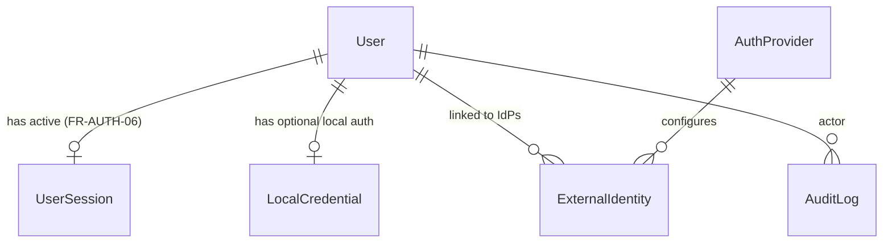

# AUTH_DATABASE_DESIGN.md — Authentication & Session Database Design

> **Status:** Architecture Design Only (Read-Only Mission 02 — No Prisma Schema or Migration Modified)  
> **ORM & DB:** Prisma 6 + PostgreSQL 16 (`backend/prisma/schema.prisma`)

---

## 1. Verified Findings (ตรวจสอบจาก `backend/prisma/schema.prisma`)

1. **`model User` (lines 62–79):**
   - Fields: `id` (`Int @id @default(autoincrement())`), `email` (`String @unique`), `name` (`String`), `role` (`UserRole`), `isActive` (`Boolean @default(true)`), `expiresAt` (`DateTime?`), `createdAt`, `updatedAt`.
   - Indexes: `@@index([role, isActive])`, `@@index([expiresAt])`.
   - **สิ่งที่ยังไม่มี:** ไม่มีฟิลด์สำหรับรหัสผ่าน (Local Auth), Lockout tracking, Last login, หรือ External Identity mapping.
2. **`model UserSession` (lines 81–89):**
   - Fields: `id` (`Int @id @default(autoincrement())`), `userId` (`Int @unique`), `sessionId` (`String @unique`), `createdAt` (`DateTime @default(now())`), `lastActivityAt` (`DateTime @default(now())`).
   - Relation: `user User @relation(fields: [userId], references: [id])`.
   - **ข้อสังเกตสำคัญ:** `userId @unique` รองรับกฎ Single Active Session (`FR-AUTH-06`) อยู่แล้ว แต่ยังขาด `expiresAt` (Absolute expiration), `revokedAt`, `authMethod`, `ipAddress` / `userAgent` (สำหรับ Audit/Security) และ `onDelete: Cascade`.
3. **`enum AuditAction` & `model AuditLog` (lines 36–60, 305–323):**
   - `AuditAction` ปัจจุบันมี `USER_CREATE`, `USER_UPDATE`, `USER_ACTIVATE`, `USER_DEACTIVATE`, `USER_AUTO_DEACTIVATE`, `USER_EXTEND_EXPIRY` เป็นต้น
   - **สิ่งที่ยังไม่มี:** ยังไม่มี `AuditAction` สำหรับเหตุการณ์ Authentication เช่น Login Success/Failure, Logout, Session Revoked, Account Locked, Password Changed/Reset.

---

## 2. Proposed Design

### 2.1 Entity Relationship Overview

### 2.2 Proposed Schema Changes (Draft Specification — Not Applied)

#### A. `User` (Minimal Extension)
- เพิ่มฟิลด์:
  - `lastLoginAt DateTime?`
- *เหตุผล:* แยกข้อมูลรหัสผ่านและ Lockout ไปอยู่ตาราง `LocalCredential` เพื่อไม่ให้ตาราง `users` ปนกับข้อมูลเฉพาะ Local Auth เมื่อเปลี่ยนไปใช้ KKU SSO เป็นหลักในอนาคต

#### B. `LocalCredential` (New Model — Interim Local Auth)
| Field | Type | Constraints / Default | Purpose |
| :--- | :--- | :--- | :--- |
| `id` | `Int` | `@id @default(autoincrement())` | Primary Key |
| `userId` | `Int` | `@unique` | FK -> `User.id` (`onDelete: Cascade`) |
| `passwordHash` | `String` | Required | Argon2id PHC string |
| `mustChangePassword` | `Boolean` | `@default(false)` | บังคับเปลี่ยนรหัสผ่านหลัง Admin Reset / Initial Provision |
| `passwordChangedAt` | `DateTime` | `@default(now())` | ติดตามอายุรหัสผ่าน |
| `failedAttempts` | `Int` | `@default(0)` | นับจำนวนครั้งที่ล็อกอินผิดติดกัน |
| `lockedUntil` | `DateTime?` | Nullable | เวลาปลดล็อกอัตโนมัติ |
| `lastFailedAt` | `DateTime?` | Nullable | เวลาล้มเหลวล่าสุด (สำหรับ reset window) |
| `createdAt` / `updatedAt` | `DateTime` | Auto | Audit timestamps |

#### C. `UserSession` (Extend Existing Model)
| Field | Type | Constraints / Default | Purpose |
| :--- | :--- | :--- | :--- |
| `id` | `Int` | `@id @default(autoincrement())` | Existing |
| `userId` | `Int` | `@unique` | Existing — enforces `FR-AUTH-06` (1 active session/user) |
| `sessionId` | `String` | `@unique` | เก็บ **SHA-256 hash** ของ Session Token (ไม่เก็บ raw token) |
| `authProvider` | `String` | `@default("local")` | `'local'` หรือ provider key ในอนาคต |
| `createdAt` | `DateTime` | `@default(now())` | ใช้คำนวณ Absolute Timeout |
| `lastActivityAt` | `DateTime` | `@default(now())` | ใช้คำนวณ Idle Timeout (60 นาที) |
| `expiresAt` | `DateTime` | Required | Absolute expiration timestamp |
| `revokedAt` | `DateTime?` | Nullable | Soft-revocation timestamp (หรือลบแถวเมื่อ Logout) |
| `ipAddress` | `String?` | `@db.VarChar(45)` | IPv4/IPv6 สำหรับ Security Audit |
| `userAgent` | `String?` | `@db.VarChar(512)` | Browser/Client metadata |

- **Indexes:**
  - `@@index([expiresAt])` (สำหรับ Cleanup job)
  - `@@index([lastActivityAt])`
- *หมายเหตุ:* หากต้องการให้ `FR-AUTH-06` แสดง `MSG-28` ("บัญชีของคุณถูกเข้าสู่ระบบจากอุปกรณ์อื่น") ได้แม่นยำ เมื่อมีการ Login ใหม่สามารถ `upsert` ทับแถวเดิมด้วย `sessionId` ใหม่ (หรือย้าย Session เก่า/บันทึกเหตุการณ์ใน `AuditLog`)

#### D. `AuthProvider` & `ExternalIdentity` (SSO Integration Boundary — Future Ready)
> **หมายเหตุ:** ออกแบบโดยไม่สมมติ Protocol ของ KKU SSO

**`AuthProvider`:**
- `id` (`Int @id @default(autoincrement())`)
- `code` (`String @unique`) — เช่น `'kku_sso'`
- `displayName` (`String`)
- `protocol` (`String`) — ค่าที่รองรับกำหนดภายหลังตามคำตอบ KKU IT (ไม่ hardcode protocol enum ล่วงหน้า)
- `isEnabled` (`Boolean @default(false)`)
- `configJson` (`Json?`) — Metadata/Endpoint non-secret config (Secrets เก็บใน Env/Secret Manager เท่านั้น)
- `createdAt`, `updatedAt`

**`ExternalIdentity`:**
- `id` (`Int @id @default(autoincrement())`)
- `userId` (`Int`) — FK -> `User.id` (`onDelete: Cascade`)
- `providerId` (`Int`) — FK -> `AuthProvider.id`
- `externalSubject` (`String`) — Immutable unique user ID จาก IdP (ไม่ใช่ display name)
- `externalEmail` (`String?`) — Email ล่าสุดที่ได้รับจาก IdP
- `lastAuthenticatedAt` (`DateTime?`)
- `createdAt`, `updatedAt`
- **Unique Constraints:** `@@unique([providerId, externalSubject])` (1 External Identity ผูกกับ 1 User เท่านั้น)
- **Indexes:** `@@index([userId])`

#### E. `AuditAction` Enum Additions
เพิ่มค่าใน `enum AuditAction`:
- `AUTH_LOGIN_SUCCESS`
- `AUTH_LOGIN_FAILED`
- `AUTH_LOGOUT`
- `AUTH_SESSION_REVOKED`
- `AUTH_ACCOUNT_LOCKED`
- `AUTH_PASSWORD_CHANGED`
- `AUTH_PASSWORD_RESET`

### 2.3 Data Retention & Privacy

- `UserSession`: ลบ Session ที่หมดอายุหรือถูกเพิกถอนเกิน **7 วัน**
- `AuditLog`: เก็บตามนโยบายสถาบัน/PDPA (เสนออย่างน้อย **1 ปี** หรือตลอดอายุโครงการ; ห้ามเก็บรหัสผ่าน, raw session token, หรือ citizenId ใน `detail`/`oldValue`/`newValue`)

### 2.4 Migration Risks

1. **Existing `user_sessions` Rows:** ปัจจุบันตารางว่าง (ไม่ได้ใช้งาน) แต่การเพิ่มคอลัมน์ `expiresAt` แบบ NOT NULL ต้องใช้ default หรือ `TRUNCATE user_sessions` ใน Migration (ปลอดภัยเพราะยังไม่มีการใช้งานจริง)
2. **Existing Seeded Users (`backend/prisma/seed.ts`):** มี User 4 ราย (`admin@kku.ac.th`, `evaluator1..3@kku.ac.th`) ที่ยังไม่มี `LocalCredential` — ต้องมีขั้นตอน Initial Provisioning โดยไม่ hardcode รหัสผ่านใน Migration หรือ Source Code

---

## 3. Assumptions

1. `User.email` ยังคงเป็น `@unique` และใช้เป็นตัวจับคู่เบื้องต้นกับ `@kku.ac.th` / `@kkumail.com` (`BR-USR-02`)
2. 1 User มี `UserSession` ที่ Active ได้เพียง 1 รายการ (`FR-AUTH-06`)

---

## 4. Open Questions

1. ต้องการเก็บประวัติ Session ย้อนหลังในตารางแยกหรือไม่ หรือใช้ `AuditLog` (`AUTH_LOGIN_SUCCESS`, `AUTH_SESSION_REVOKED`) ก็เพียงพอแล้ว?
2. KKU SSO จะส่ง Immutable Subject ID (เช่น `sub` / `uid` / `employeeId`) หรือส่งเฉพาะ Email? (จะยืนยันจาก `QUESTIONS_FOR_KKU_IT.md`)

---

## 5. Risks

| Risk | Impact | Mitigation |
| :--- | :--- | :--- |
| **เก็บ Raw Session ID ใน DB** | หาก DB รั่วไหล ผู้โจมตีสวมรอย Session ได้ | เก็บเฉพาะ SHA-256 hash ของ Token ใน `user_sessions.sessionId` |
| **Migration เพิ่มคอลัมน์ NOT NULL** | Migration ล้มเหลวหากมีข้อมูลค้าง | ตรวจสอบตาราง `user_sessions` ก่อน migrate และกำหนด default ชั่วคราวหรือล้างข้อมูลชั่วคราว |

---

## 6. Decisions Required from Developer

1. **อนุมัติการแยก `LocalCredential` ออกจาก `User`** (เพื่อให้ถอดหรือปิด Local Auth ได้สะอาดในอนาคต)
2. **อนุมัติการเก็บ `ipAddress` และ `userAgent` ใน `UserSession` / `AuditLog`** เพื่อความปลอดภัยและสอดคล้องกับ PDPA
3. **อนุมัติโครงสร้าง `ExternalIdentity` และ `AuthProvider`** สำหรับรองรับ KKU SSO ในอนาคต
