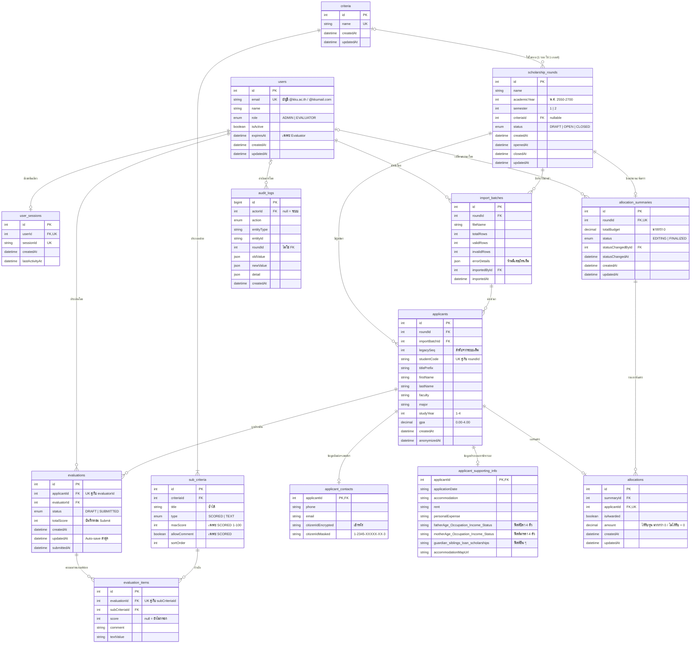
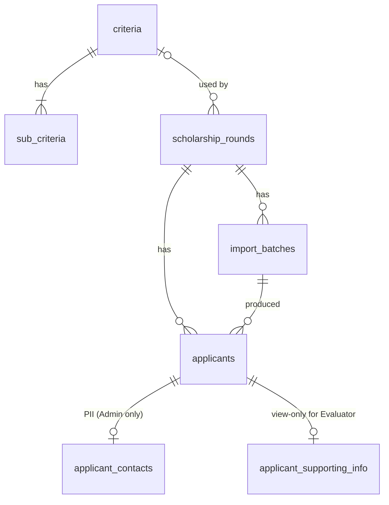
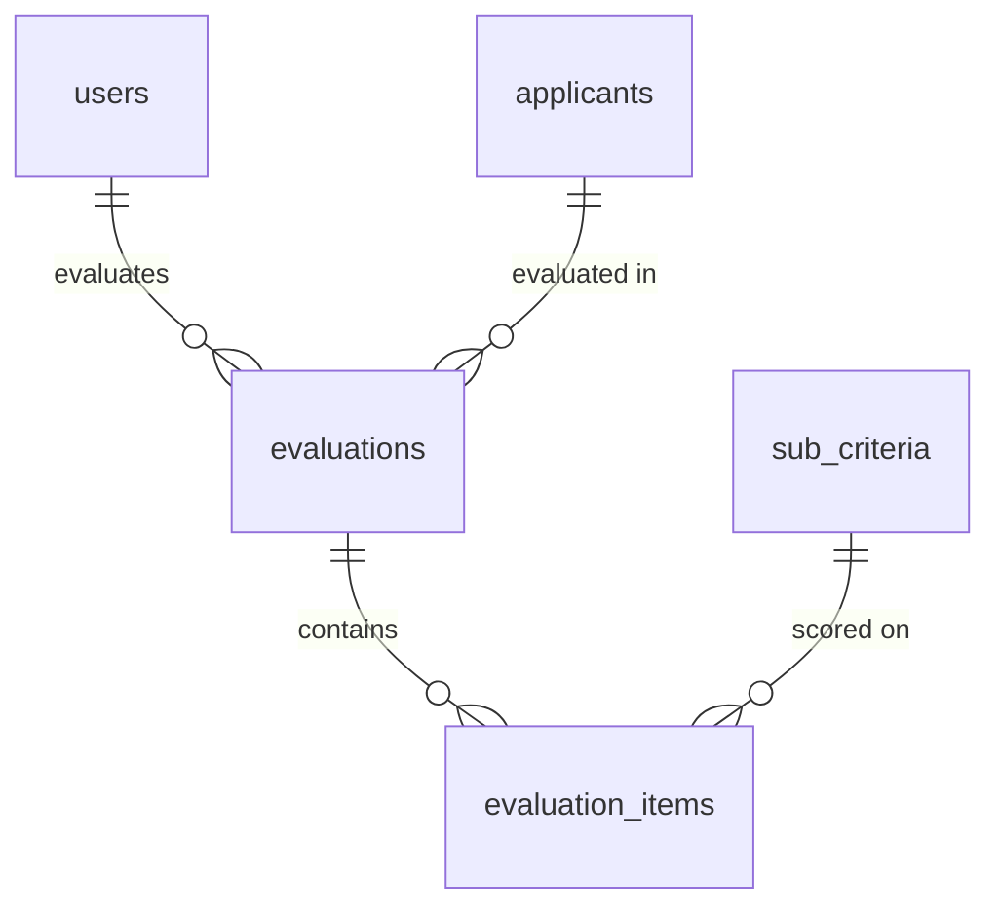
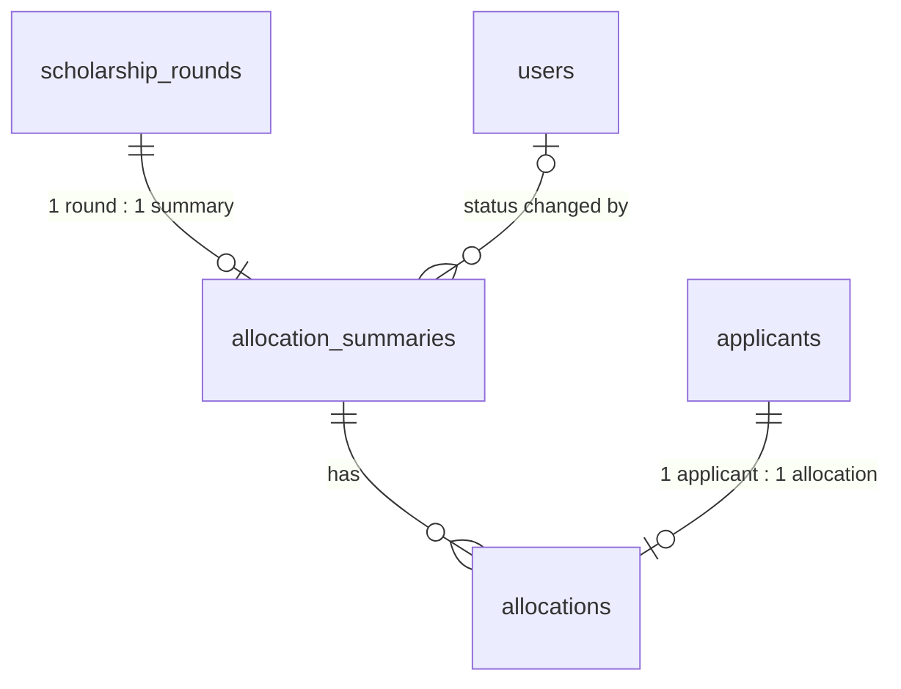

# SEMS — ER Diagram

สร้างจาก `schema.prisma` (PostgreSQL) · อ้างอิง Scope, BR v1.2, FRS v0.1, NFR v0.1
เปิดดูได้ใน GitHub / VS Code (Mermaid preview) / mermaid.live

## 1. ER Diagram (ทั้งระบบ)

> หมายเหตุการอ่าน: `applicant_supporting_info` ใน diagram ย่อฟิลด์ที่คล้ายกันเป็นกลุ่มเพื่อให้อ่านง่าย รายการฟิลด์เต็มอยู่ใน `schema.prisma` / `schema.md`

## 2. มุมมองแยกตามโดเมน

### 2.1 รอบทุน เกณฑ์ และผู้สมัคร

### 2.2 การประเมินและอันดับ

อันดับและคะแนนสุดท้าย **ไม่มีตาราง** คำนวณจาก `evaluations` ที่ `status = SUBMITTED` (ค่าเฉลี่ยของ `totalScore`, ไม่มี Submitted = 0.00, เรียงคะแนนมาก→น้อย เท่ากันเรียง `studentCode` น้อย→มาก)

### 2.3 การจัดสรรทุน

ยอดจัดสรรแล้ว = SUM(`allocations.amount`), งบคงเหลือ = `totalBudget` − ยอดจัดสรรแล้ว (คำนวณ ไม่เก็บ)

## 3. สรุป Cardinality ที่สำคัญ

| ความสัมพันธ์ | จำนวน | ที่มา |
|---|---|---|
| รอบทุน → เกณฑ์ | N : 0..1 (1 รอบใช้ 1 เกณฑ์ ใช้เกณฑ์ซ้ำหลายรอบได้) | BR-RND-07, BR-CRT-10 |
| เกณฑ์ → เกณฑ์ย่อย | 1 : N (ต้องมี SCORED ≥ 1) | BR-CRT-04 |
| รอบทุน → ผู้สมัคร | 1 : N (ผู้สมัครคนเดียวกันอยู่หลายรอบ = คนละแถว) | BR-IMP-09 |
| ผู้สมัคร ↔ Evaluator | M : N ผ่าน `evaluations` (unique ต่อคู่) | BR-EVL-02 |
| รอบทุน → สรุปจัดสรร | 1 : 0..1 (สร้างตอนตั้งงบครั้งแรก) | BR-ALC-04 |
| ผู้สมัคร → ผลจัดสรร | 1 : 0..1 | BR-ALC-04 |
