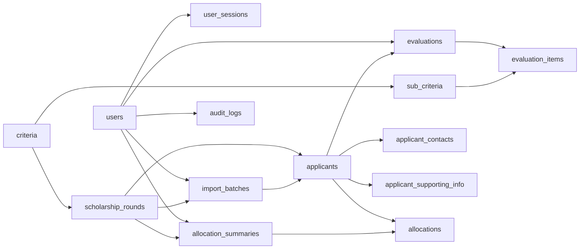

# SEMS — สรุปความสัมพันธ์ระหว่างตาราง (อะไรต้องเชื่อมกับอะไร)

อ้างอิง `schema.prisma` · 14 ตาราง · 18 Foreign Key
รูปแบบอ่าน: **ลูก → พ่อ** หมายถึง ตารางลูกถือ FK ชี้ไปหาตารางพ่อ

---

## 1. ภาพรวมในหนึ่งภาพ



ลูกศรชี้จาก **ตารางพ่อ → ตารางลูก** (ลูกถือ FK)

**ตารางศูนย์กลาง (Hub):**
- `scholarship_rounds` — จุดรวมของรอบ: เชื่อมเกณฑ์ ผู้สมัคร ประวัตินำเข้า และสรุปจัดสรร
- `applicants` — จุดรวมของผู้สมัคร: เชื่อมข้อมูลติดต่อ ข้อมูลประกอบ การประเมิน และผลจัดสรร
- `users` — เชื่อมกับ 5 ตาราง (เซสชัน นำเข้า ประเมิน จัดสรร log)

---

## 2. รายการเชื่อมต่อทั้ง 18 FK

| # | ตารางลูก | FK (คอลัมน์) | → ตารางพ่อ | Cardinality (พ่อ : ลูก) | หมายเหตุ |
|---|---|---|---|---|---|
| 1 | `user_sessions` | userId | `users` | 1 : 0..1 | เซสชันเดียวต่อบัญชี |
| 2 | `sub_criteria` | criteriaId | `criteria` | 1 : N | เกณฑ์หนึ่งมีหลายเกณฑ์ย่อย |
| 3 | `scholarship_rounds` | criteriaId | `criteria` | 0..1 : N | 1 รอบใช้ 1 เกณฑ์, เกณฑ์เดียวใช้หลายรอบ |
| 4 | `import_batches` | roundId | `scholarship_rounds` | 1 : N | |
| 5 | `import_batches` | importedById | `users` | 1 : N | ผู้นำเข้า (Admin) |
| 6 | `applicants` | roundId | `scholarship_rounds` | 1 : N | |
| 7 | `applicants` | importBatchId | `import_batches` | 1 : N | |
| 8 | `applicant_contacts` | applicantId (PK) | `applicants` | 1 : 0..1 | PII, Cascade |
| 9 | `applicant_supporting_info` | applicantId (PK) | `applicants` | 1 : 0..1 | Cascade |
| 10 | `evaluations` | applicantId | `applicants` | 1 : N | |
| 11 | `evaluations` | evaluatorId | `users` | 1 : N | ผู้ประเมิน (Evaluator) |
| 12 | `evaluation_items` | evaluationId | `evaluations` | 1 : N | Cascade |
| 13 | `evaluation_items` | subCriteriaId | `sub_criteria` | 1 : N | |
| 14 | `allocation_summaries` | roundId | `scholarship_rounds` | 1 : 0..1 | |
| 15 | `allocation_summaries` | statusChangedById | `users` | 0..1 : N | ผู้เปลี่ยนสถานะล่าสุด |
| 16 | `allocations` | summaryId | `allocation_summaries` | 1 : N | |
| 17 | `allocations` | applicantId | `applicants` | 1 : 0..1 | |
| 18 | `audit_logs` | actorId | `users` | 0..1 : N | null = ระบบ |

---

## 3. รายตาราง: ตารางนี้เชื่อมกับตารางไหนบ้าง

**ขาเข้า (←)** = ตารางนี้ถือ FK ชี้ไปหาตารางอื่น (ต้องมีพ่อ)
**ขาออก (→)** = ตารางอื่นถือ FK ชี้มาหาตารางนี้ (เป็นพ่อ)

| ตาราง | ← ต้องเชื่อมกับ (ตารางนี้ถือ FK) | → ถูกเชื่อมโดย (ตารางอื่นถือ FK) |
|---|---|---|
| `users` | — | `user_sessions`, `import_batches`, `evaluations`, `allocation_summaries`, `audit_logs` |
| `user_sessions` | `users` | — |
| `criteria` | — | `sub_criteria`, `scholarship_rounds` |
| `sub_criteria` | `criteria` | `evaluation_items` |
| `scholarship_rounds` | `criteria` (ว่างได้ใน Draft) | `import_batches`, `applicants`, `allocation_summaries` |
| `import_batches` | `scholarship_rounds`, `users` | `applicants` |
| `applicants` | `scholarship_rounds`, `import_batches` | `applicant_contacts`, `applicant_supporting_info`, `evaluations`, `allocations` |
| `applicant_contacts` | `applicants` | — |
| `applicant_supporting_info` | `applicants` | — |
| `evaluations` | `applicants`, `users` (Evaluator) | `evaluation_items` |
| `evaluation_items` | `evaluations`, `sub_criteria` | — |
| `allocation_summaries` | `scholarship_rounds`, `users` (ว่างได้) | `allocations` |
| `allocations` | `allocation_summaries`, `applicants` | — |
| `audit_logs` | `users` (ว่างได้ = ระบบ) | — |

**ตารางปลายทาง (ไม่มีใครอ้างต่อ):** `user_sessions`, `applicant_contacts`, `applicant_supporting_info`, `evaluation_items`, `allocations`, `audit_logs`
**ตารางราก (ไม่ต้องมีพ่อ):** `users`, `criteria`

---

## 4. ความสัมพันธ์ที่ "ต้องเชื่อม" ตามกฎธุรกิจ

| กฎ | เชื่อมอะไรกับอะไร | บังคับด้วย |
|---|---|---|
| 1 รอบใช้ 1 เกณฑ์ | `scholarship_rounds.criteriaId` → `criteria` | DB: FK เดี่ยว (BR-RND-07) |
| เกณฑ์เดียวใช้ซ้ำหลายรอบ | `criteria` ← หลาย `scholarship_rounds` | DB: ไม่มี unique บน criteriaId (BR-CRT-10) |
| ผู้สมัครหนึ่งแถวผูกกับรอบเดียว | `applicants.roundId` | DB: FK; ผู้สมัครคนเดียวกันในอีกรอบ = อีกแถว (BR-IMP-09) |
| รหัสนักศึกษาไม่ซ้ำในรอบ | `applicants (roundId, studentCode)` | DB: unique ผสม (BR-IMP-04) |
| Evaluator ประเมินผู้สมัครรายเดิมซ้ำไม่ได้ | `evaluations (evaluatorId, applicantId)` | DB: unique ผสม (BR-EVL-02) |
| 1 เกณฑ์ย่อยมีคะแนน 1 ค่าต่อการประเมิน | `evaluation_items (evaluationId, subCriteriaId)` | DB: unique ผสม |
| 1 รอบมีสรุปจัดสรรได้ 1 ชุด | `allocation_summaries.roundId` | DB: unique (BR-ALC-04) |
| 1 ผู้สมัครมีผลจัดสรรได้ 1 รายการ | `allocations.applicantId` | DB: unique |
| 1 บัญชีมีเซสชันเดียว | `user_sessions.userId` | DB: unique (BR-EVL-08) |
| `evaluation_items.subCriteriaId` ต้องเป็นเกณฑ์ย่อยของเกณฑ์ที่รอบนั้นใช้ | evaluation → applicant → round → criteria → sub_criteria | **Backend** (DB ตรวจข้ามหลายตารางไม่ได้) |
| `allocations` ต้องเป็นผู้สมัครของรอบเดียวกับ `allocation_summaries` | allocation → applicant.roundId = summary.roundId | **Backend** |
| คนที่ประเมินต้องมี role = EVALUATOR | `evaluations.evaluatorId` → users.role | **Backend** |
| ผู้ดำเนินการต้อง role = ADMIN | `import_batches.importedById`, `allocation_summaries.statusChangedById` | **Backend** |

---

## 5. เส้นทาง Join ที่ใช้บ่อย (ตาม Use Case)

| งาน | เส้นทาง Join |
|---|---|
| **คะแนนสุดท้าย + อันดับของรอบ** (Admin ดูผล/ส่งออกรายงานสรุป) | `scholarship_rounds` → `applicants` → `evaluations` (เฉพาะ SUBMITTED, เฉลี่ย totalScore) · ถ้าต้องการรายละเอียด → `evaluation_items` → `sub_criteria` และ `users` (ชื่อผู้ประเมิน) |
| **รายชื่อผู้สมัครสำหรับ Evaluator** | `scholarship_rounds` (status = OPEN) → `applicants` · LEFT JOIN `evaluations` เฉพาะของ Evaluator คนนั้น (สถานะการประเมินของตน) · นับ Submitted ทั้งหมดต่อผู้สมัคร · **ห้าม join `applicant_contacts`** |
| **หน้าฟอร์มประเมิน** | `applicants` → `applicant_supporting_info` (ข้อมูลประกอบ) · `applicants.roundId` → `scholarship_rounds.criteriaId` → `criteria` → `sub_criteria` (หัวข้อที่ต้องกรอก) · `evaluations` → `evaluation_items` (ค่าที่กรอกไว้) |
| **ตรวจก่อนปิดรอบ** (ผู้สมัครที่ไม่มี Submitted เลย) | `applicants` (roundId = X) LEFT JOIN `evaluations` (SUBMITTED) แล้วเลือกแถวที่ไม่มีคู่ |
| **ตรวจก่อนเปิดรอบ** | `scholarship_rounds` → `applicants` (นับ ≥ 1) · `criteria` → `sub_criteria` (SUM maxScore ของ SCORED = 100) · `import_batches` ล่าสุดของรอบ (จำนวน invalid) |
| **ตรวจว่าเกณฑ์แก้ไขได้ไหม** | `criteria` → `scholarship_rounds` ที่ status ∈ (OPEN, CLOSED) ถ้ามี = แก้ไม่ได้ |
| **ตรวจก่อนปิดบัญชี Evaluator** | `users` → `evaluations` (DRAFT) → `applicants` → `scholarship_rounds` (OPEN) |
| **หน้าจัดสรรทุน** | `scholarship_rounds` → `allocation_summaries` → `allocations` → `applicants` · คะแนนสุดท้ายคำนวณจาก `evaluations` (ใช้เช็กกฎ "คะแนน 0 ห้ามรับทุน") |
| **หน้ารายละเอียดจัดสรรรายบุคคล** (Admin เท่านั้น) | `allocations` → `applicants` → `applicant_contacts` (เลขบัตรแบบปิดบัง/เต็ม, โทรศัพท์, อีเมล) แล้วเขียน `audit_logs` เมื่อกดดูเลขเต็ม |
| **ส่งออกรายงานจัดสรร** | `allocation_summaries` (FINALIZED) → `allocations` → `applicants` → `applicant_contacts` + คะแนน/อันดับจาก `evaluations` |
| **ส่งออกรายงานสรุปผล** | เหมือนข้อคะแนนสุดท้าย แต่ **ไม่ join `applicant_contacts`** |
| **นำเข้าผู้สมัครแบบแทนที่** (เฉพาะรอบ Draft) | สร้าง `import_batches` ใหม่ → ลบ `applicants` เดิมของรอบ (Cascade ไป `applicant_contacts`, `applicant_supporting_info`) → สร้าง `applicants` + ลูกใหม่ ทั้งหมดใน transaction เดียว |

---

## 6. ลำดับการสร้างข้อมูล (ตามการพึ่งพากันของ FK)

ตารางที่อยู่ลำดับก่อนต้องมีข้อมูลก่อนจึงสร้างตารางถัดไปได้

| ลำดับ | ตาราง | ต้องมีก่อน |
|---|---|---|
| 1 | `users`, `criteria` | — |
| 2 | `user_sessions`, `sub_criteria`, `scholarship_rounds` | users / criteria / criteria (ว่างได้) |
| 3 | `import_batches` | scholarship_rounds, users |
| 4 | `applicants` | scholarship_rounds, import_batches |
| 5 | `applicant_contacts`, `applicant_supporting_info` | applicants |
| 6 | `evaluations` | applicants, users |
| 7 | `evaluation_items` | evaluations, sub_criteria |
| 8 | `allocation_summaries` | scholarship_rounds |
| 9 | `allocations` | allocation_summaries, applicants |
| — | `audit_logs` | เขียนได้ทุกเมื่อ (actorId ว่างได้) |

ลำดับการลบ (กรณีล้างข้อมูลทดสอบ) ให้ย้อนกลับจากล่างขึ้นบน — ตัวระบบจริงไม่มีฟังก์ชันลบผู้ใช้/รอบทุน

---

## 7. ความเชื่อมโยงที่ไม่ใช่ Foreign Key (ตั้งใจ)

| ความเชื่อมโยง | ทำไมไม่ใช้ FK | วิธีหาข้อมูล |
|---|---|---|
| `audit_logs.roundId` ↔ `scholarship_rounds` | log ต้องอยู่คงทน 6 ปีและไม่ผูกกับวงจรชีวิตข้อมูล | เก็บเป็นเลขอ้างอิงเฉย ๆ |
| `audit_logs.entityType + entityId` ↔ ตารางเป้าหมาย | ชี้ได้หลายตาราง (polymorphic) | เก็บเป็นข้อความ |
| `evaluations` ↔ `scholarship_rounds` | หาได้ผ่าน `applicants.roundId` ไม่เก็บซ้ำ | join ผ่าน applicants |
| `allocations` ↔ `scholarship_rounds` | หาได้ผ่าน `allocation_summaries.roundId` | join ผ่าน summary |

---

## 8. ภาพรวมความสัมพันธ์แบบเดียว (สรุปท้ายเอกสาร)

```
users ─┬─ user_sessions
       ├─ import_batches ──┐
       ├─ evaluations      │
       ├─ allocation_summaries
       └─ audit_logs       │
                           ▼
criteria ─┬─ sub_criteria ──────────────┐
          └─ scholarship_rounds ─┬─ import_batches ─┐
                                 ├─ applicants ◄────┘
                                 │    ├─ applicant_contacts
                                 │    ├─ applicant_supporting_info
                                 │    ├─ evaluations ── evaluation_items ◄── sub_criteria
                                 │    └─ allocations ◄── allocation_summaries
                                 └─ allocation_summaries
```
