# SEMS-KKU REST API Specification & Architecture Blueprint (v2.8)
**Scholarship Evaluation Management System (SEMS)**  
*ระบบบริหารจัดการการประเมินทุนการศึกษา มหาวิทยาลัยขอนแก่น*  
*ฉบับสมบูรณ์ขั้นสูงสุด (OpenAPI & Postman Benchmark — Final Sealed Specification)*

---

## 1. ภาพรวมสถาปัตยกรรมและความปลอดภัย (Architecture & Security Hardening)

```mermaid
flowchart LR
    Client["Client App\n(Next.js App Router)"] -->|"HTTPS / JSON\nSameSite Cookie + Custom Header"| Gateway["NestJS API Gateway\n(/api/v1/*)"]
    
    subgraph Backend ["NestJS Backend Application"]
        Gateway --> BodyParser["Body Parser & Multer Layer\n(Global 1MB / preview-excel 50MB)"]
        BodyParser --> IpThrottler["IP Rate Limiter Guard (100/min)\n(@nestjs/throttler -> 429)"]
        IpThrottler --> LogMiddleware["Sanitizing Log Middleware\n(Redact: password, citizenId)"]
        LogMiddleware --> CSRF["CSRF & Origin Guard (X-Requested-With)\n403 CSRF_REJECTED"]
        CSRF --> Auth["Session Guard (JWT + DB Check)\nIdle Timeout + Single Device Check"]
        Auth --> UserThrottler["User-scoped Rate Limiter\n(Allocations 30/m, Reveal 10/m, Export 5/m)"]
        UserThrottler --> Roles["RBAC Guard (Admin vs Evaluator)\n403 on Cross-Role Access"]
        Roles --> ScopeGuard["Evaluator Scope Guard\n(Open-Round Check / 404 on IDOR)"]
        ScopeGuard --> Pipe["Validation Pipe\n(class-validator / Zod)"]
        Pipe --> Services["Business Logic Services\n(Pessimistic Lock & Transaction)"]
        Services --> Audit["Audit Logger Service\n(PDPA Compliance)"]
        Services --> Prisma["Prisma Client"]
    end
    
    Prisma --> DB[("PostgreSQL\nDatabase")]
```



### 1.1 สถาปัตยกรรมเครือข่าย การตรวจสอบสิทธิ์ และ CSRF Mitigation
1. **Network Topology & CORS:**
   - Client (Next.js) และ Backend (NestJS) อยู่ภายใต้ Parent Domain เดียวกัน (เช่น `sems.kku.ac.th` กับ `api.sems.kku.ac.th`)
   - กำหนด CORS Whitelist แบบเข้มงวด รองรับ `credentials: true` และระบุ Cookie Domain สำหรับทั้งระบบ
2. **Session Storage & CSRF Mitigation (NFR-SEC-10):**
   - ส่ง Session ผ่าน Cookie แบบ `HttpOnly`, `Secure`, `SameSite=Lax`
   - ป้องกัน CSRF ข้ามไซต์ด้วยการบังคับ Custom Header: `X-Requested-With: XMLHttpRequest` ในทุก Mutation Request (`POST`, `PUT`, `PATCH`, `DELETE`)
   - **การส่งออกไฟล์ (Export):** Client ต้องดาวน์โหลดผ่าน `fetch()` พร้อมแนบ Custom Header และแปลง Response เป็น Blob ฝั่ง Client เพื่อความปลอดภัย แทนการใช้ Form Submit แบบดั้งเดิม
3. **Single Active Session & Idle Timeout (BR-EVL-08, BR-SYS-02):**
   - ตรวจสอบ `sessionId` บนตาราง `user_sessions` ทุกคำขอ หากไม่ตรงกันให้ตัดการทำงานทันที คืนค่า HTTP 401 พร้อม `errorCode: "SESSION_REPLACED"` (MSG-28)
   - ตรวจสอบ `lastActivityAt`: หากไม่มีการใช้งานเกินค่า Idle Timeout จาก Config (ค่าเริ่มต้น 3600 วินาทีตาม BR-SYS-02) ให้ตัดเซสชันและคืนค่า HTTP 401 พร้อม `errorCode: "SESSION_IDLE_TIMEOUT"` (MSG-28)
   - อัปเดต `lastActivityAt` แบบ Throttled Write (อัปเดตลงตารางเฉพาะเมื่อคำขอล่าสุดห่างจากค่าเดิมในฐานข้อมูลเกิน 60 วินาที) เพื่อลดภาระ Write I/O
4. **SSO Integration Protocol `[TBD]` & CSRF Exemption:**
   - รองรับ Callback Endpoint แบบกลางที่ `POST /api/v1/auth/sso/callback`
   - **ข้อยกเว้น CSRF:** Endpoint นี้เป็น Public Auth Entry Point ที่รองรับการแลกเปลี่ยน Token หรือการ Redirect ข้ามไซต์จาก KKU SSO IdP จึง**ได้รับการยกเว้นจากการตรวจสอบ `X-Requested-With` Header** (CSRF Guard Bypass) ชั่วคราว และจะทบทวนปรับให้ตรงกับ Binding จริง (เช่น SAML HTTP-POST Form หรือ OIDC Authorization Code) เมื่อสรุป Protocol
   - **หมายเหตุด้านสถาปัตยกรรม:** สำหรับผู้ใช้ทั้งมหาวิทยาลัยที่อาจอยู่หลัง NAT IP เดียวกัน การตั้งค่า IP Throttler ในระดับ 100 คำขอ/นาที (และ 30 คำขอ/นาที บน SSO Callback) เพื่อป้องกัน Brute-force/DDoS มีความเสี่ยงต่อ False Positive หากมีการเข้าใช้งานพร้อมกันเป็นจำนวนมาก จึงแนะนำให้ตั้งค่า Reverse Proxy (Nginx/Traefik) ให้อ่าน Client IP ที่แท้จริงผ่าน Header เช่น `X-Forwarded-For` / `CF-Connecting-IP` และอาจจำเป็นต้องปรับเพิ่มโควตา IP Throttler หรือใช้ Subnet-based / Session-assisted Throttling ในสภาพแวดล้อม Production

### 1.2 การคุ้มครองข้อมูลส่วนบุคคล (PDPA), Rate Limiting และ Log Redaction
1. **Zero Logging of Sensitive Data (FR-EXP-07):**
   - ติดตั้ง Logging Interceptor / Middleware ตัด (Redact) ค่าในฟิลด์ `password`, `citizenId`, `citizenIdEncrypted`, และ `authorization` ออกจากทุกระดับของ Log (Console, Log File, Proxy, และ APM)
2. **นโยบายการป้องกัน IDOR (403 vs 404):**
   - **กรณี Role ผิด (Cross-Role):** หาก Evaluator พยายามเรียก Endpoint ที่เป็นของ Admin (เช่น `/api/v1/allocations/*` หรือ `/api/v1/users/*`) ระบบจะส่งกลับ **`HTTP 403 Forbidden`**
   - **กรณีอยู่นอก Scope ของ Evaluator (Data IDOR):** ใน Endpoint ที่ Evaluator มีสิทธิ์เรียกได้ตามหลักการ หากพยายามเข้าถึง Resource (รอบทุน, ผู้สมัคร, หรือเกณฑ์) ที่ไม่อยู่ในสถานะ `OPEN` และ Evaluator **ไม่มีระเบียน evaluation ของตนเอง** ระบบจะส่งกลับ **`HTTP 404 Not Found`** เพื่อไม่ให้เปิดเผยว่ามี ID นั้นอยู่ในระบบ ป้องกันการสุ่มเจาะสำรวจข้อมูล (Enumeration Attack)
3. **การเข้าถึงข้อมูลติดต่อในหน้ารายละเอียดการจัดสรร (BR-PDP-05):**
   - `GET /api/v1/allocations/:id`: คืนข้อมูล Masked Citizen ID (`1-2345-XXXXX-XX-3`), โทรศัพท์ และอีเมล **โดยไม่บันทึก Audit Log** ซึ่งเป็นการตัดสินใจตามข้อกำหนด BR-PDP-05 อย่างเจตนา แต่เพื่อลดความเสี่ยงของการขูดข้อมูล (Scraping) Endpoint นี้ถูกจำกัด Rate Limit ระดับ User
   - `POST /api/v1/allocations/:id/reveal-citizen-id`: ถอดรหัสเลขบัตรประชาชนเต็ม 13 หลัก และ **บังคับบันทึก Audit Log (`VIEW_CITIZEN_ID`) ทันทีใน Transaction เดียวกันก่อนส่งค่ากลับ** (FR-ALC-10, BR-PDP-04)
4. **Rate Limiting Matrix (@nestjs/throttler):**
   - `POST /api/v1/auth/sso/callback`: 30 คำขอ / นาที / IP (จำกัดความถี่เข้มงวดเป็นพิเศษเพื่อป้องกัน Brute-force บน Auth Entry Point ก่อนสร้าง Session)
   - `GET /api/v1/allocations/:id`: 30 คำขอ / นาที / User (ป้องกันการไล่เก็บข้อมูลเบอร์โทร/อีเมลทั้งรอบ)
   - `POST /api/v1/allocations/:id/reveal-citizen-id`: 10 คำขอ / นาที / User (ป้องกันการขูดเลขบัตรประชาชนเต็ม)
   - `POST /api/v1/reports/*/export`: 5 คำขอ / นาที / User
   - `POST /api/v1/scholarship-rounds/:roundId/applicants/preview-excel`: 3 คำขอ / นาที / User
   - ทรัพยากรทั่วไป: 100 คำขอ / นาที / IP (Layer 1) และตามสิทธิ์ผู้ใช้ (Layer 4)

---

## 2. มาตรฐานการตอบกลับ โครงสร้างข้อมูล และ Error Handling

### 2.1 ลำดับการตรวจสอบข้อผิดพลาด (Strict Error Pipeline)
จัดลำดับการตรวจสอบเพื่อความถูกต้องตามหลักสถาปัตยกรรมและทดสอบได้ง่าย:
0. **`413 Payload Too Large` (Body Parser Layer):**
   - กำหนดขีดจำกัดขนาด Payload ทั่วไปของระบบไว้ที่ **1 MB** (Global Limit)
   - กำหนดขีดจำกัดขนาด 50 MB เฉพาะที่ Route Handler ของ `POST /scholarship-rounds/:roundId/applicants/preview-excel` (ผ่านการตั้งค่า Multer เฉพาะ Endpoint)
   - **หมายเหตุด้านความปลอดภัยและสถาปัตยกรรม:** ชั้น Body Parser / Multer จะประมวลผลและตอบกลับ `413 Payload Too Large` (`FILE_TOO_LARGE`) ก่อนที่จะถึง Throttler Guard (Layer 1) และ Auth Guard เสมอ หากมีข้อมูลเกินเพดานที่กำหนดไว้
1. **`429 Too Many Requests` (Layer 1: IP-based Throttler Guard):**
   - ตรวจจับความถี่คำขอในระดับ IP Address (100 คำขอ/นาที/IP ทั่วไป และจำกัดเข้มงวด 30 คำขอ/นาที สำหรับ SSO Callback) เพื่อป้องกัน DDoS/Brute-force ก่อนเข้าถึงชั้น Session
   - เกินอัตราคำขอส่งกลับ `errorCode: "RATE_LIMITED"` พร้อม Header `Retry-After` และ `params: { retryAfterSeconds }`
2. **`403 Forbidden` (Layer 2: CSRF Guard):**
   - สำหรับทุก Mutation Request (`POST`, `PUT`, `PATCH`, `DELETE`) ต้องมี Custom Header `X-Requested-With: XMLHttpRequest` หากขาดหรือไม่ถูกต้อง ส่งกลับ **`403 CSRF_REJECTED`**
3. **`401 Unauthorized` (Layer 3: Session Guard):**
   - ตรวจสอบเซสชันบนฐานข้อมูล: ไม่พบ Token, Token หมดอายุ, Session ถูกตัด (`SESSION_REPLACED`), Session หมดเวลา (`SESSION_IDLE_TIMEOUT`), หรือบัญชีถูกปิด (`ACCOUNT_DEACTIVATED`)
4. **`429 Too Many Requests` (Layer 4: User-scoped Throttler Guard):**
   - เมื่อผ่านการยืนยันตัวตนสำเร็จแล้ว ระบบจะคุม Rate Limit รายผู้ใช้ (User ID):
     - `GET /allocations/:id` (30/นาที/User)
     - `POST /allocations/:id/reveal-citizen-id` (10/นาที/User)
     - `POST /reports/*/export` (5/นาที/User)
     - `POST .../preview-excel` (3/นาที/User)
5. **`403 Forbidden` (Layer 5: RBAC Roles Guard):**
   - สิทธิ์ตาม Role ไม่ตรง (Cross-Role Endpoint เช่น Evaluator พยายามเข้าถึง Resource ของ Admin) ส่งกลับ `errorCode: "FORBIDDEN"`
6. **`404 Not Found` (Layer 6: Resource & IDOR Scope Guard):**
   - ไม่พบ Resource ตาม ID หรือ Evaluator พยายามเข้าถึง Resource นอกขอบเขตของตนในรอบที่ไม่ใช่ OPEN (Data IDOR Protection)
7. **`409 Conflict` (Layer 7: State Invalidation):**
   - ทรัพยากรอยู่ในสถานะที่ไม่ถูกต้องต่อการทำงาน (`CRITERIA_LOCKED`, `INVALID_ROUND_STATUS`, `INVALID_ALLOCATION_STATUS`, `ROUND_CLOSED`, `ROUND_CLOSE_STATE_CHANGED`, `STALE_VERSION`, `ALLOCATION_LOCKED_FINALIZED`, `ALREADY_EVALUATED`)
   - **หมายเหตุลำดับของ Preview Token ในคำขอนำเข้า (`/import`):** สถานะของรอบทุน (`DRAFT`) จะได้รับการตรวจสอบก่อนในระดับ Parent Round (Layer 7: 409 `INVALID_ROUND_STATUS`) จากนั้นจึงตรวจสอบความถูกต้องและการคงอยู่ของ Temp File / Preview Token ของ Request Body (Layer 8: 404 `PREVIEW_TOKEN_INVALID` หรือ 410 `PREVIEW_TOKEN_EXPIRED` / `PREVIEW_TOKEN_ALREADY_USED`)
8. **`410 Gone` (Layer 8: Token Lifecycle):**
   - Preview Token หมดเวลา 30 นาที (`PREVIEW_TOKEN_EXPIRED`) หรือถูกใช้งานไปแล้ว (`PREVIEW_TOKEN_ALREADY_USED`)
9. **`422 Unprocessable Entity` (Layer 9: Business Logic & Pre-steps):**
   - ข้อมูลผิดกฎธุรกิจ หรือ ขาดขั้นตอนที่ต้องมีก่อน (เช่น ไม่ได้ส่ง Flag รับทราบ, ผลรวมคะแนนไม่เท่ากับ 100, คะแนนเกิน Max, งบประมาณติดลบ, บัญชีหมดอายุเริ่มผู้สมัครใหม่)

### 2.2 โครงสร้าง Response Envelope มาตรฐาน
**Success Response:**
```json
{
  "success": true,
  "statusCode": 200,
  "data": { ... },
  "meta": {
    "page": 1,
    "limit": 20,
    "total": 150,
    "totalPages": 8
  }
}
```

**Error Response (Semantic Error Code + Dynamic Params):**
```json
{
  "success": false,
  "statusCode": 422,
  "errorCode": "CRITERIA_SUM_NOT_100",
  "error": "UNPROCESSABLE_ENTITY",
  "params": {
    "sum": 85
  },
  "timestamp": "2026-10-06T13:55:00.000+07:00"
}
```

### 2.3 ตารางความสัมพันธ์ Semantic Error Code ↔ Message Code (BR-SYS-01, MSG-01 ถึง MSG-33)

| Semantic Error Code | HTTP Status | แมปกับ MSG | พารามิเตอร์ (`params`) | เงื่อนไข / กฎทางธุรกิจ |
|---|:---:|:---:|---|---|
| `FILE_TOO_LARGE` | 413 | MSG-11 | `maxSize: "50MB"` | ไฟล์อัปโหลดขนาดเกิน 50 MB (BR-IMP-02) ตรวจสอบที่ Body Parser |
| `RATE_LIMITED` | 429 | *(ระบบ)* | `retryAfterSeconds: number` | เรียกคำขอเกินความถี่ที่ระบบอนุญาต (IP / User Throttler Guard) |
| `CSRF_REJECTED` | 403 | *(ระบบ)* | — | ขาด Custom Header X-Requested-With ในคำขอ Mutation (NFR-SEC-10) |
| `UNAUTHORIZED` | 401 | *(ระบบ)* | — | ขาด Session หรือ Session ไม่ถูกต้อง |
| `FORBIDDEN` | 403 | *(ระบบ)* | — | ไม่มีสิทธิ์ตามบทบาท (RBAC Guard) |
| `NOT_FOUND` | 404 | *(ระบบ)* | — | ไม่พบข้อมูล หรือซ่อนทรัพยากรตามนโยบาย IDOR Guard |
| `ACCOUNT_DEACTIVATED` | 401 | MSG-01 | — | บัญชีถูกปิดการใช้งาน หรือไม่ได้รับสิทธิ์ (BR-USR-01) |
| `SESSION_REPLACED` | 401 | MSG-28 | — | มีการล็อกอินจากเครื่องอื่น (BR-EVL-08) |
| `SESSION_IDLE_TIMEOUT` | 401 | MSG-28 | — | ไม่มีการใช้งานเกิน Idle Timeout (BR-SYS-02) |
| `CANNOT_DEACTIVATE_EVALUATOR_WITH_DRAFT` | 422 | MSG-02 | — | Evaluator มี Draft ค้างในรอบ Open (BR-USR-09) |
| `CANNOT_DEACTIVATE_SELF_OR_LAST_ADMIN` | 422 | MSG-03 | — | Admin ปิดตนเองหรือปิด Admin คนสุดท้าย (BR-USR-14) |
| `EXPIRY_DAYS_REQUIRED` | 422 | MSG-04 | — | เปิดใช้งาน Evaluator ที่เคยปิด ต้องระบุวันหมดอายุ (BR-USR-08) |
| `CRITERIA_SUM_NOT_100` | 422 | MSG-06 | `sum: number` | ผลรวมคะแนน Scored ไม่เท่ากับ 100 (BR-CRT-06) |
| `MAX_SCORE_OUT_OF_RANGE` | 422 | MSG-07 | — | คะแนนเต็มเกณฑ์ย่อยต้องเป็น 1–100 (BR-CRT-05) |
| `SCORED_CRITERIA_REQUIRED` | 422 | MSG-08 | — | เกณฑ์ต้องมีข้อแบบ Scored อย่างน้อย 1 ข้อ (BR-CRT-04) |
| `CRITERIA_LOCKED` | 409 | MSG-09 | — | เกณฑ์ถูกใช้ในรอบ Open/Closed แล้ว ห้ามแก้ (BR-CRT-09) |
| `ROUND_OPEN_PRECHECK_FAILED` | 422 | MSG-10 | `reasons: string[]` | ไม่ผ่านเงื่อนไขเปิดรอบ (FR-RND-08) |
| `INVALID_EXCEL_FILE` | 422 | MSG-11 | — | ไฟล์ไม่ใช่ .xlsx หรือโครงสร้างไฟล์เสียหาย (BR-IMP-02) |
| `INVALID_EXCEL_ROW` | 422 | MSG-12 | `row: number`, `reason: string` | ข้อผิดพลาดรายแถวใน Excel (BR-IMP-03..08) |
| `EXCEL_NO_VALID_ROWS` | 422 | MSG-13 | — | ไม่มีแถวใดผ่านการตรวจ (BR-IMP-12) |
| `EXCEL_INVALID_ROWS_ACK_REQUIRED` | 422 | MSG-14 | `count: number` | ต้องกดยืนยันรับทราบแถว invalid ก่อนนำเข้า (BR-IMP-11) |
| `PREVIEW_TOKEN_INVALID` | 404 | *(ระบบ)* | — | โทเค็นไม่ถูกต้อง หรือเป็นของผู้ใช้อื่น (BR-IMP-11) |
| `PREVIEW_TOKEN_EXPIRED` | 410 | *(ระบบ)* | — | โทเค็นหมดอายุ 30 นาที (BR-IMP-11) |
| `PREVIEW_TOKEN_ALREADY_USED` | 410 | *(ระบบ)* | — | โทเค็นถูกนำเข้าหรือยกเลิกไปแล้ว (BR-IMP-16) |
| `SCORE_OUT_OF_RANGE` | 422 | MSG-15 | `max: number` | คะแนนไม่อยู่ในช่วง 0 ถึง Max (BR-EVL-03) |
| `SCORES_INCOMPLETE` | 422 | MSG-16 | `items: string[]` | ส่งผลประเมินแต่กรอกคะแนน Scored ไม่ครบ (BR-EVL-11) |
| `ALREADY_EVALUATED` | 409 | MSG-17 | — | การประเมินถูก Submitted ไปแล้ว ไม่อนุญาตให้แก้ไขซ้ำ (BR-EVL-02, BR-EVL-09) |
| `EVALUATOR_EXPIRED_NEW_APPLICANT` | 422 | MSG-18 | — | บัญชีหมดอายุเริ่มประเมินผู้สมัครใหม่ไม่ได้ (ตรวจเฉพาะกรณีไม่มี Draft เดิม BR-USR-11) |
| `ROUND_CLOSED` | 409 | MSG-19 | — | รอบทุนถูกปิดแล้ว ห้ามบันทึก/ส่งผล (สำหรับผู้ประเมินที่มี Draft เดิมค้างอยู่ BR-RND-13) |
| `ROUND_CLOSE_STATE_CHANGED` | 409 | MSG-20 | `count: number`, `applicants: UnsubmittedApplicantItem[]` (`{ applicantId: number, studentCode: string, titlePrefix: string, firstName: string, lastName: string }[]`) | จำนวนผู้สมัครที่ไม่มีผลเปลี่ยนไปจากที่รับทราบ ต้องตรวจเช็คใหม่ |
| `ROUND_CLOSE_ACK_REQUIRED` | 422 | MSG-20 | `count: number`, `applicants: UnsubmittedApplicantItem[]` (`{ applicantId: number, studentCode: string, titlePrefix: string, firstName: string, lastName: string }[]`) | มีผู้สมัครไม่มี Submitted ต้องส่ง acknowledged: true และ acknowledgedCount (FR-RND-12) |
| `BUDGET_MUST_BE_POSITIVE` | 422 | MSG-21 | — | งบประมาณรวมต้อง > 0 บาท (BR-ALC-02) |
| `CANNOT_EDIT_BUDGET_ALLOCATED` | 422 | MSG-22 | `allocated: number` | แก้งบรวมไม่ได้เนื่องจากมียอดจัดสรรแล้ว (BR-ALC-03) |
| `ALLOCATION_EXCEEDS_BUDGET` | 422 | MSG-23 | `total: number`, `budget: number`| ยอดจัดสรรเกินงบประมาณรวม (BR-ALC-05) |
| `ALLOCATION_AMOUNT_MISMATCH` | 422 | MSG-24 | — | สถานะรับทุนและจำนวนเงินไม่สัมพันธ์กัน (BR-ALC-06) |
| `ZERO_SCORE_CANNOT_AWARD` | 422 | MSG-25 | — | ผู้สมัครคะแนน 0.00 ห้ามได้รับทุน (BR-ALC-07) |
| `ALLOCATION_LOCKED_FINALIZED` | 409 | MSG-26 | — | ผลจัดสรรเป็น Finalized ต้องเปิดแก้ไขก่อน (BR-ALC-12) |
| `INVALID_ROUND_STATUS` | 409 | MSG-27 | `status: string`, `action: "update_round" \| "open_round" \| "close_round" \| "link_criteria" \| "import_applicants" \| "set_budget" \| "export_ranking_report"` | การดำเนินการไม่อนุญาตในสถานะรอบปัจจุบัน (BR-IMP-01, BR-ALC-01, ฯลฯ) |
| `INVALID_ALLOCATION_STATUS` | 409 | MSG-27 | `status: string`, `action: "finalize_allocation" \| "reopen_allocation" \| "export_report"` | การดำเนินการไม่อนุญาตในสถานะจัดสรรปัจจุบัน (BR-ALC-11, 12) |
| `EMAIL_ALREADY_EXISTS_OR_INVALID` | 422 | MSG-29 | — | อีเมลซ้ำหรือโดเมนไม่ใช่ KKU (BR-USR-02) |
| `VALIDITY_DAYS_INVALID` | 422 | MSG-30 | — | จำนวนวันต้องเป็นจำนวนเต็มบวก (BR-USR-04) |
| `CRITERIA_NAME_DUPLICATE` | 422 | MSG-31 | — | ชื่อเกณฑ์การประเมินซ้ำ (BR-CRT-01) |
| `EXCEL_MISSING_SHEET_OR_COLUMNS` | 422 | MSG-32 | `columns: string[]` | ไม่พบชีต Data หรือขาดคอลัมน์บังคับ (BR-IMP-18, 19) |
| `ACADEMIC_YEAR_OUT_OF_RANGE` | 422 | MSG-33 | — | ปีการศึกษาต้องเป็น พ.ศ. 2550–2700 (BR-RND-01) |
| `SEMESTER_OUT_OF_RANGE` | 422 | *(ระบบ)* | — | ภาคเรียนต้องเป็น 1 หรือ 2 (BR-RND-02) |
| `STALE_VERSION` | 409 | *(ระบบ)* | `serverUpdatedAt: string` | คำขอ Auto-save เก่ากว่าข้อมูลปัจจุบันบนเซิร์ฟเวอร์ |

---

## 3. สรุปรายละเอียด Endpoints รายโมดูล (API Endpoints Specification)

### Module 1: Authentication & Session (`/auth`)
*รองรับ Use Case: UC-01, UC-02, UC-03*

| Method | Endpoint | สิทธิ์ | คำอธิบาย & กฎทางธุรกิจ |
|---|---|---|---|
| `POST` | `/api/v1/auth/sso/callback` `[TBD]` | Public | รับ SSO payload (Rate limit: 30/min/IP), ตรวจสอบอีเมลโดเมน KKU (BR-USR-02), สร้าง Session บน `user_sessions`, แทนที่ session เดิมหากมี (BR-EVL-08), ตั้งค่า HttpOnly Cookie |
| `POST` | `/api/v1/auth/logout` | Authenticated | สิ้นสุดเซสชัน ลบแถวใน `user_sessions` และล้าง Cookie |
| `GET` | `/api/v1/auth/me` | Authenticated | คืนโปรไฟล์ผู้ใช้, Role, `expiresAt` (Evaluator), **`serverTime` (ISO 8601)** เพื่อให้ Client เทียบเวลาไม่เพี้ยนจากนาฬิกาเครื่อง, และ **`idleTimeoutSeconds`** (ดึงจาก Config ของระบบ เช่น 3600) เพื่อให้ Frontend ทำการนับถอยหลังเตือนก่อน Session หมดอายุ |

---

### Module 2: User Management (`/users`)
*รองรับ Use Case: UC-A01*

| Method | Endpoint | สิทธิ์ | คำอธิบาย & กฎทางธุรกิจ |
|---|---|---|---|
| `GET` | `/api/v1/users` | `ADMIN` | แสดงรายการบัญชีผู้ใช้ (Server Pagination: `page`, `limit`, `sortBy`, `sortOrder`, ตัวกรอง `role`, `isActive`, `search`) |
| `POST` | `/api/v1/users` | `ADMIN` | เพิ่มผู้ใช้ใหม่: อีเมลต้องไม่ซ้ำ, Admin ไม่มีวันหมดอายุ, Evaluator รับ `{ days: number }` (BR-USR-04), ล็อกฟิลด์ `role` ห้ามแก้ไขหลังสร้าง *(Log: USER_CREATE)* |
| `GET` | `/api/v1/users/:id` | `ADMIN` | ดูรายละเอียดผู้ใช้ |
| `PATCH` | `/api/v1/users/:id` | `ADMIN` | แก้ไขชื่อผู้ใช้ *(Log: USER_UPDATE)* |
| `PATCH` | `/api/v1/users/:id/status` | `ADMIN` | เปิด/ปิดการใช้งานบัญชี:<br>• **ปิด:** ป้องกัน Admin ปิดตนเองหรือปิด Admin คนสุดท้าย (MSG-03); ป้องกันการปิด Evaluator ที่มี Draft ค้างในรอบ Open (MSG-02)<br>• **เปิด:** สำหรับ Evaluator บังคับส่ง Body `{ "days": number }` เพื่อคำนวณวันหมดอายุใหม่เสมอ (MSG-04) *(Log: USER_ACTIVATE / USER_DEACTIVATE)* |
| `PATCH` | `/api/v1/users/:id/extend-expiry` | `ADMIN` | ต่ออายุ Evaluator: Body `{ "days": number }` คำนวณวันหมดอายุใหม่นับจากวันที่กดยืนยัน (BR-USR-07) *(Log: USER_EXTEND_EXPIRY)* |

---

### Module 3: Scholarship Rounds (`/scholarship-rounds`)
*รองรับ Use Case: UC-A02, UC-A07, Scope 1.3.2.5*

| Method | Endpoint | สิทธิ์ | คำอธิบาย & กฎทางธุรกิจ |
|---|---|---|---|
| `GET` | `/api/v1/scholarship-rounds` | `ADMIN`, `EVALUATOR` | รายการรอบทุน:<br>• **Admin:** เห็นทุกสถานะ (Pagination & Filters)<br>• **Evaluator:** เห็นเฉพาะรอบสถานะ `OPEN` เท่านั้น (BR-EVL-01) |
| `POST` | `/api/v1/scholarship-rounds` | `ADMIN` | สร้างรอบใหม่ (สถานะตั้งต้น `DRAFT`, ปีการศึกษา พ.ศ. 2550–2700, ภาคเรียน 1 หรือ 2) |
| `GET` | `/api/v1/scholarship-rounds/:id` | `ADMIN`, `EVALUATOR` | รายละเอียดรอบทุน: **ป้องกัน IDOR:** หาก Evaluator เรียกและรอบไม่ใช่ `OPEN` ให้ตอบ **`404 Not Found`** |
| `PATCH` | `/api/v1/scholarship-rounds/:id` | `ADMIN` | แก้ไขข้อมูลรอบทุน (ทำได้เฉพาะรอบสถานะ `DRAFT` BR-RND-05, MSG-27 `action: "update_round"`) |
| `PATCH` | `/api/v1/scholarship-rounds/:id/criteria` | `ADMIN` | เชื่อม/เปลี่ยน/ถอดเกณฑ์: Body `{ "criteriaId": number \| null }` (ทำได้เฉพาะรอบ `DRAFT` BR-RND-07, MSG-09) |
| `GET` | `/api/v1/scholarship-rounds/:id/open-check` | `ADMIN` | ตรวจความพร้อมก่อนเปิดรอบ (ข้อมูลครบ, ผู้สมัคร ≥ 1, เกณฑ์ Scored = 100) และคืน `lastInvalidRowsCount` (FR-RND-08/09) |
| `POST` | `/api/v1/scholarship-rounds/:id/open` | `ADMIN` | เปิดรอบทุน (`DRAFT` → `OPEN`): ตรวจความพร้อมทุกข้อ หากผ่านจะล็อกข้อมูลรอบ ผู้สมัคร และเกณฑ์ *(Log: ROUND_STATUS_CHANGE)* |
| `GET` | `/api/v1/scholarship-rounds/:id/close-check` | `ADMIN` | ตรวจสอบก่อนปิดรอบ: คืน `{ unsubmittedCount: number, applicants: [...] }` รายชื่อผู้สมัครที่ไม่มีสถานะ `SUBMITTED` เลย (FR-RND-12, MSG-20) |
| `POST` | `/api/v1/scholarship-rounds/:id/close` | `ADMIN` | **ปิดรอบทุน (`OPEN` → `CLOSED`):**<br>• Server คำนวณจำนวนผู้สมัครที่ไม่มี Submitted จริงใน Transaction เดียวกัน<br>• **ลำดับตรวจ ACK (หมายเหตุผู้พัฒนา: ต้องตรวจ `acknowledgedCount !== undefined` ป้องกัน Falsy check เมื่อค่าเป็น 0):**<br>&nbsp;&nbsp;1. หาก `unsubmittedCount == 0`: ปิดรอบได้ทันทีโดย Client ไม่ต้องส่ง `acknowledged`<br>&nbsp;&nbsp;2. หาก `unsubmittedCount > 0` และ Client ไม่ได้ส่ง `acknowledged: true` หรือ `acknowledgedCount === undefined`: ส่งกลับ **`422 ROUND_CLOSE_ACK_REQUIRED`** (MSG-20)<br>&nbsp;&nbsp;3. หาก `unsubmittedCount > 0` แต่ `acknowledgedCount` ที่ Client ส่งมาไม่ตรงกับยอดจริงของ Server: ส่งกลับ **`409 ROUND_CLOSE_STATE_CHANGED`** พร้อมรายชื่อใหม่<br>• ปิดรอบแล้วล็อกผล Draft ทั้งหมดถาวร (BR-RND-13) *(Log: ROUND_STATUS_CHANGE บันทึกจำนวนจริงที่ server ตรวจพบลง detail)* |

---

### Module 4: Evaluation Criteria (`/criteria`)
*รองรับ Use Case: UC-A03*

| Method | Endpoint | สิทธิ์ | คำอธิบาย & กฎทางธุรกิจ |
|---|---|---|---|
| `GET` | `/api/v1/criteria` | `ADMIN` | รายการเกณฑ์ทั้งหมด พร้อมแสดงรอบทุนที่นำเกณฑ์ไปใช้ (FR-CRT-12) |
| `POST` | `/api/v1/criteria` | `ADMIN` | สร้างเกณฑ์ใหม่: ชื่อไม่ซ้ำ (MSG-31), มี Scored ≥ 1 ข้อ (MSG-08), ผลรวม Scored เท่ากับ 100 (MSG-06) *(Log: CRITERIA_CREATE)* |
| `GET` | `/api/v1/criteria/:id` | `ADMIN`, `EVALUATOR` | รายละเอียดเกณฑ์และเกณฑ์ย่อย: **ป้องกัน IDOR:** สำหรับ Evaluator อนุญาตให้เข้าถึงได้เฉพาะเกณฑ์ที่**ผูกอยู่กับรอบสถานะ `OPEN` อย่างน้อยหนึ่งรอบ** เท่านั้น (BR-CRT-10) หากไม่ใช่ให้ตอบ **`404 Not Found`** |
| `PUT` | `/api/v1/criteria/:id` | `ADMIN` | แก้ไขชุดเกณฑ์: ทำได้เฉพาะเกณฑ์ที่ยังไม่ถูกใช้ในรอบ `OPEN` หรือ `CLOSED` (MSG-09) และ **ต้องรักษา `id` ของเกณฑ์ย่อยเดิมไว้ (Update in-place)** ไม่ลบสร้างใหม่ทั้งหมด เพื่อคง Foreign Key อ้างอิง *(Log: CRITERIA_UPDATE)* |

---

### Module 5: Applicants & Excel Import (`/scholarship-rounds/:roundId/applicants`)
*รองรับ Use Case: UC-A04, UC-A05, UC-A06, UC-E01, UC-E02, Scope 1.3.2.5*

| Method | Endpoint | สิทธิ์ | คำอธิบาย & กฎทางธุรกิจ |
|---|---|---|---|
| `POST` | `/api/v1/scholarship-rounds/:roundId/applicants/preview-excel` | `ADMIN` | อัปโหลด `.xlsx` (Multer File Limit: 50 MB, Rate limit: 3/min):<br>• หากไฟล์เกิน 50 MB ส่งกลับ **`413 FILE_TOO_LARGE`** (BR-IMP-02)<br>• ตรวจสอบรอบทุนต้องอยู่ในสถานะ `DRAFT` หากไม่ใช่ส่งกลับ **`409 INVALID_ROUND_STATUS`** (`action: "import_applicants"`)<br>• Parse ข้อมูลและจัดเก็บผลแบบเข้ารหัสบน Encrypted Server Scratch Storage คืนค่า `{ previewToken, totalRows, validRows, invalidRows, expiresAt, rows: [{ rowNumber, studentCode, titlePrefix, firstName, lastName, faculty, major, studyYear, gpa, maskedCitizenId, isValid, errors }] }` โดยแสดง Masked Citizen ID และไม่มีเลขบัตรเต็ม (FR-IMP-08) (Token อายุ 30 นาที, ผูกกับ Admin ID และ Round ID, ใช้ครั้งเดียว) |
| `POST` | `/api/v1/scholarship-rounds/:roundId/applicants/import` | `ADMIN` | ยืนยันนำเข้า: Body `{ previewToken, acknowledgedInvalidRows: boolean }`; ตรวจสอบตามลำดับ Pipeline (§2.1): ตรวจรอบเป็น `DRAFT` ก่อน (หากไม่ใช่คืน 409 `INVALID_ROUND_STATUS`), แล้วจึงตรวจ Token (หากไม่พบคืน 404 `PREVIEW_TOKEN_INVALID`, หากหมดเวลาคืน 410 `PREVIEW_TOKEN_EXPIRED`, หากเคยใช้แล้วคืน 410 `PREVIEW_TOKEN_ALREADY_USED`), ตรวจสอบการรับทราบแถวผิดพลาด (หากมี invalid rows และไม่ได้ส่ง acknowledge คืน 422 `EXCEL_INVALID_ROWS_ACK_REQUIRED`), นำเข้าแบบ Atomic Transaction แทนที่ชุดเดิมทั้งหมด (BR-IMP-13), บันทึก Batch คืนค่า `{ importBatchId, importedCount, skippedCount }` และ **ลบ Temp Scratch File ทิ้งทันที** (BR-IMP-16) *(Log: IMPORT_APPLICANTS)* |
| `DELETE`| `/api/v1/scholarship-rounds/:roundId/applicants/import-previews/:previewToken` | `ADMIN` | ยกเลิกพรีวิว: ตรวจสอบสิทธิ์ความเป็นเจ้าของ Token และความถูกต้องของ Round ID แล้วสั่งลบ Temp File ทิ้งทันที (FR-IMP-13, BR-IMP-16) *(มี Background Cron Job คอยล้าง Temp Storage ที่ค้างเกิน 30 นาที)* |
| `GET` | `/api/v1/scholarship-rounds/:roundId/applicants` | `ADMIN`, `EVALUATOR` | รายชื่อผู้สมัคร (Server Pagination: `page`, `limit` สูงสุด 100, `search`, `faculty`, `myStatus`, `sortBy`, `sortOrder`):<br>• **ป้องกัน IDOR:** หาก Evaluator เรียกและ `:roundId` ไม่ใช่ `OPEN` ให้ตอบ **`404 Not Found`**<br>• **ADMIN:** ค้นหาตามรหัส/ชื่อ/คณะ แสดงตาราง View-only ข้อมูลการศึกษา `studentCode, titlePrefix, firstName, lastName, faculty, major, studyYear, gpa` และ **`legacySeq` (ลำดับแถวเดิมจาก Excel)** โดยไม่แสดงเบอร์/อีเมล/เลขบัตร/ข้อมูลประกอบ (BR-APP-02)<br>• **EVALUATOR:** แสดงข้อมูลการศึกษาพร้อม **`legacySeq` (ลำดับจากระบบเดิมตาม FR-APP-03)**, `submittedCount`, สถานะตนเอง `myStatus` (`NOT_STARTED` / `DRAFT` / `SUBMITTED`), และแฟล็ก `canStart: boolean` (เป็น `false` หาก Evaluator หมดอายุและยังไม่มี Draft ของผู้สมัครนี้ ตาม BR-USR-11) |
| `GET` | `/api/v1/applicants/:id` | `ADMIN`, `EVALUATOR` | รายละเอียดผู้สมัครรายบุคคล:<br>• **ป้องกัน IDOR:** หาก Evaluator เรียกและรอบของผู้สมัครไม่ใช่ `OPEN` ให้ตอบ **`404 Not Found`**<br>• **ADMIN:** คืนเฉพาะฟิลด์พื้นฐานทางการศึกษา + **`legacySeq`** **ไม่คืน Supporting Info** (BR-APP-02) และไม่มีเบอร์/อีเมล/เลขบัตรประชาชน (ข้อมูลติดต่อดูได้เฉพาะที่ `/allocations/:id`)<br>• **EVALUATOR:** คืนฟิลด์พื้นฐานทางการศึกษา + **`legacySeq` (FR-APP-03)** + `supportingInfo` + ลิงก์แผนที่ **ไม่คืนเลขบัตรประชาชน, โทรศัพท์, อีเมล** (NFR-SEC-04) |
| `GET` | `/api/v1/scholarship-rounds/:roundId/applicants/imports` | `ADMIN` | ประวัติการนำเข้าของรอบทุน (Batch List, วันเวลา, ผู้ดำเนินการ, แถวที่ผ่าน/ไม่ผ่าน) (Scope 1.3.2.5) |

---

### Module 6: Evaluations & Results (`/applicants/:applicantId/my-evaluation`, `/evaluations`)
*รองรับ Use Case: UC-E03, UC-E04, UC-E05, UC-A08, FR-EVL-14*

| Method | Endpoint | สิทธิ์ | คำอธิบาย & กฎทางธุรกิจ |
|---|---|---|---|
| `GET` | `/api/v1/applicants/:applicantId/my-evaluation` | `EVALUATOR` | **ดึงผลการประเมินของผู้ประเมินสำหรับผู้สมัครนี้ (FR-EVL-14):**<br>• หากมี evaluation อยู่เดิม: อนุญาตให้ดึงข้อมูลได้ทั้งในรอบ `OPEN` และรอบ `CLOSED` (คืนสถานะ Draft/Submitted พร้อมคะแนน, Comment, `updatedAt` และ **ฝังโครงสร้าง `subCriteria: { id, title, type, maxScore, allowComment }` มาในแต่ละ Item** เพื่อให้หน้าผลประเมินแสดงรายละเอียดเกณฑ์ย่อยในรอบ Closed ได้ครบถ้วนโดยไม่ต้องเรียก GET `/criteria/:id`)<br>• หากไม่มี evaluation อยู่เดิม: ตรวจสอบรอบของผู้สมัคร หากรอบไม่ใช่ `OPEN` ให้ตอบ **`404 Not Found`** (ป้องกัน IDOR) |
| `PUT` | `/api/v1/applicants/:applicantId/my-evaluation` | `EVALUATOR` | **Auto-save / Upsert Draft:** Body `{ items: [...], clientUpdatedAt?: string }`<br>• **การจัดการสถานะรอบ Closed และ IDOR:**<br>&nbsp;&nbsp;- หากมี evaluation อยู่เดิมและรอบเป็น `CLOSED`: คืน **`409 ROUND_CLOSED`** (MSG-19 ตาม BR-EVL-12)<br>&nbsp;&nbsp;- หากไม่มี evaluation อยู่เดิมและรอบไม่ใช่ `OPEN`: คืน **`404 Not Found`**<br>• **ลำดับตรวจ:** ตรวจผลต้องไม่เป็น Submitted (หาก Submitted แล้วคืน 409 `ALREADY_EVALUATED` MSG-17) → ตรวจ Evaluator หมดอายุ: หากเป็น **"ผู้สมัครใหม่ที่ยังไม่มี Draft เดิม"** คืน 422 `EVALUATOR_EXPIRED_NEW_APPLICANT` (MSG-18); หากมี Draft เดิมอนุญาตให้แก้ต่อได้ตาม BR-USR-11<br>• **Concurrency & No-op Check:** หาก Payload ข้อมูลตรงกับใน DB ทุกฟิลด์ ไม่ต้องเขียน DB และไม่ต้องขยับ `updatedAt` (คืน 200); หากมีข้อมูลเปลี่ยนและ `clientUpdatedAt` เก่ากว่าใน DB คืน **`409 STALE_VERSION`** พร้อม `{ serverUpdatedAt }` |
| `POST` | `/api/v1/applicants/:applicantId/my-evaluation/submit` | `EVALUATOR` | **ยืนยันส่งผลการประเมิน (`DRAFT` → `SUBMITTED`):**<br>• **ลำดับตรวจที่ถูกต้อง:** ดำเนินการใน Transaction พร้อม **Lock แถวรอบทุน (Pessimistic FOR SHARE)** → ตรวจรอบยังเป็น `OPEN` (หาก Closed คืน 409 `ROUND_CLOSED` MSG-19) → ตรวจสถานะผลประเมินต้องไม่เคย `SUBMITTED` มาก่อน (409 `ALREADY_EVALUATED` MSG-17) → ตรวจคะแนน Scored ครบทุกข้อ (หากไม่ครบ คืน 422 `SCORES_INCOMPLETE` MSG-16)<br>• บันทึกคะแนนรวมและล็อกผลถาวร (BR-EVL-12) *(Log: EVALUATION_SUBMIT)* |
| `GET` | `/api/v1/evaluations/my` | `EVALUATOR` | **รายการผลการประเมินของฉัน (FR-EVL-14, FR-SYS-04):** แสดงประวัติที่ตนเคยประเมิน (ครอบคลุมทั้งรอบ `OPEN` และ `CLOSED`) พร้อม Server Pagination & Filters:<br>• **Query Parameters:** `page` (default: 1), `limit` (default: 20, max: 100), `roundId` (integer, optional), `status` (`DRAFT` \| `SUBMITTED`, optional), `sortBy` (`updatedAt` \| `submittedAt`, default: `updatedAt`), `sortOrder` (`asc` \| `desc`, default: `desc`)<br>• **Nested Context Data:** ฝังข้อมูลรอบทุน `{ id, name, academicYear, semester }` และข้อมูลเกณฑ์ `{ id, name }` มาในแต่ละรายการ เพื่อให้ Evaluator ดูสรุปผลของตนในรอบ Closed ได้ครบถ้วน<br>• **สถานะและการล็อก:** มีฟิลด์ `status` ('DRAFT' / 'SUBMITTED') และฟิลด์ **`isLocked: true`** เฉพาะกรณีที่เป็น Draft ในรอบที่ Closed ไปแล้ว เพื่อให้ UI แสดงผลแบบ Read-only และแจ้งเตือน MSG-19<br>• **Response Format:** คืนข้อมูลตาม Standard Paginated Envelope (`data: [...]`, `meta: { page, limit, total, totalPages }`) |
| `GET` | `/api/v1/scholarship-rounds/:roundId/evaluation-results` | `ADMIN` | แสดงตารางคะแนนรวมเฉลี่ย Real-time, จำนวน Submitted, และอันดับ Tie-break (BR-SCR-05) แบบแบ่งหน้า คำนวณผ่าน `ScoreCalculationService` |
| `GET` | `/api/v1/applicants/:id/evaluation-results` | `ADMIN` | รายละเอียดคะแนนรายผู้ประเมิน, Comment, Text value เฉพาะผลที่มีสถานะ `SUBMITTED` เท่านั้น โดย Admin สามารถเปิดดูได้ในทุกสถานะของรอบ (FR-SCR-06, E9) |

---

### Module 7: Allocations & Reports (`/allocations`, `/reports`)
*รองรับ Use Case: UC-A09, UC-A10, UC-A11, UC-A12, UC-A14, UC-A15*

| Method | Endpoint | สิทธิ์ | คำอธิบาย & กฎทางธุรกิจ |
|---|---|---|---|
| `GET` | `/api/v1/scholarship-rounds/:roundId/allocation-summary` | `ADMIN` | สรุปยอดงบรวม, ยอดจัดสรรแล้ว, งบคงเหลือ, สถานะ (`EDITING` / `FINALIZED`), ผู้เปลี่ยนสถานะล่าสุด |
| `PUT` | `/api/v1/scholarship-rounds/:roundId/budget` | `ADMIN` | **กำหนด/แก้งบรวม (Idempotent):** รอบต้อง `CLOSED`, งบ > 0; หากตั้งครั้งแรก ใช้ Transaction ป้องกันคำขอคู่ขนานสร้าง summary ซ้ำ; หากแก้งบและส่งยอดเดิมซ้ำ คืน 200 โดยไม่ Log ซ้ำ; หากเปลี่ยนยอดเงิน ยอดจัดสรรต้องเป็น 0 (MSG-22) *(Log: BUDGET_SET / BUDGET_UPDATE)* |
| `GET` | `/api/v1/scholarship-rounds/:roundId/allocations` | `ADMIN` | ตารางรายการจัดสรรทุน (Server Pagination & Search: `page`, `limit`, `search` รหัสนักศึกษา/ชื่อ BR-ALC-14, `isAwarded`): ไม่แสดงเลขบัตรประชาชนทั้งแบบเต็มและแบบ Masked (FR-ALC-08) |
| `GET` | `/api/v1/allocations/:id` | `ADMIN` | หน้ารายละเอียดการจัดสรรรายบุคคล (Rate limit: 30/min/User): แสดงคะแนน, เงินจัดสรร, โทรศัพท์, อีเมล, และ **Masked Citizen ID** (`1-2345-XXXXX-XX-3`) **โดยไม่บันทึก Log ตาม BR-PDP-05 โดยเจตนา** |
| `POST` | `/api/v1/allocations/:id/reveal-citizen-id` | `ADMIN` | **ขอเปิดดูเลขบัตรประชาชนเต็ม (Rate limit: 10/min/User):** ถอดรหัสเลขบัตรประชาชน และ **บันทึก Audit Log (`VIEW_CITIZEN_ID`) ทันทีใน Transaction เดียวกัน** ก่อนคืนค่า (FR-ALC-10, BR-PDP-04) |
| `PATCH` | `/api/v1/allocations/:id` | `ADMIN` | **บันทึกผลการจัดสรรรายบุคคล:** Body `{ "isAwarded": boolean, "amount": number }`<br>• ตรวจสอบสถานะต้องเป็น `EDITING` (หาก Finalized คืน 409 MSG-26)<br>• ตรวจสอบคะแนนสุดท้ายผ่าน `ScoreCalculationService` เดียวกัน: หากคะแนนเป็น 0.00 ห้ามได้รับทุน (422 MSG-25)<br>• **ป้องกัน Race Condition (NFR-DAT-02):** ดำเนินการใน Transaction โดยใช้ **`SELECT ... FOR UPDATE` ที่แถว `allocation_summaries`** คำนวณยอดรวมใหม่ หากเกินงบคืน 422 MSG-23 *(Log: ALLOCATION_UPDATE บันทึก old/new)* |
| `POST` | `/api/v1/scholarship-rounds/:roundId/allocation/finalize` | `ADMIN` | ยืนยันผลจัดสรรสำเร็จ (`EDITING` → `FINALIZED`): ล็อกผลจัดสรร (BR-ALC-11) *(Log: ALLOCATION_STATUS_CHANGE)* |
| `POST` | `/api/v1/scholarship-rounds/:roundId/allocation/reopen` | `ADMIN` | เปิดกลับมาแก้ไข (`FINALIZED` → `EDITING`): ปลดล็อกให้แก้ไขยอดจัดสรรได้ใหม่ (BR-ALC-12) *(Log: ALLOCATION_STATUS_CHANGE)* |
| `POST` | `/api/v1/reports/evaluation-ranking/export` | `ADMIN` | ส่งออกรายงานสรุปผลและอันดับ (.xlsx Rate limit: 5/min): Body `{ roundId: number, password: string }` (Redact password ออกจาก Log), รอบต้อง `CLOSED`, **คืน Binary Stream พร้อม Header `Content-Disposition`** ไม่รวมเลขบัตร (BR-EXP-06) *(Log: EXPORT_EVALUATION_REPORT)* |
| `POST` | `/api/v1/reports/allocation/export` | `ADMIN` | ส่งออกรายงานผลการจัดสรร (.xlsx Rate limit: 5/min): Body `{ roundId: number, password: string }`, สถานะจัดสรรต้อง `FINALIZED`, **คืน Binary Stream** รวมเลขบัตรประชาชนเต็ม (BR-EXP-06) *(Log: EXPORT_ALLOCATION_REPORT)* |

---

## 4. โครงสร้างซอร์สโค้ดฝั่ง Backend (NestJS Clean Architecture)

```text
backend/src/
├── common/
│   ├── constants/
│   │   └── error-messages.constant.ts   # แมป Semantic Error Codes ↔ MSG-01..33 พร้อม Parameter Types
│   ├── decorators/
│   │   ├── current-user.decorator.ts    # @CurrentUser()
│   │   └── roles.decorator.ts           # @Roles(UserRole.ADMIN)
│   ├── dto/
│   │   ├── pagination-query.dto.ts      # page, limit, sortBy, sortOrder
│   │   └── standard-response.dto.ts     # success, statusCode, data, meta
│   ├── filters/
│   │   └── global-exception.filter.ts   # จัดการ 401, 403, 404, 409, 413, 422, 429 เป็น envelope
│   ├── guards/
│   │   ├── session-auth.guard.ts        # Stateful DB session + Single device check
│   │   ├── roles.guard.ts               # RBAC (403 on Cross-Role)
│   │   └── csrf.guard.ts                # Custom header & anti-CSRF check
│   ├── interceptors/
│   │   ├── response-transform.interceptor.ts
│   │   └── sensitive-logging.interceptor.ts # Redact password & citizenId
│   └── utils/
│       ├── crypto.util.ts               # AES-256-GCM encryption/decryption [TBD]
│       └── excel-export.util.ts         # ExcelJS binary streaming & password encryption
├── modules/
│   ├── auth/                            # SSO callback, session lifecycle
│   ├── users/                           # User management, evaluator expiry
│   ├── scholarship-rounds/              # Rounds lifecycle, open/close checks
│   ├── criteria/                        # Criteria management, in-place subcriteria update
│   ├── applicants/                      # Excel stream parsing, preview tokens, bulk import
│   ├── evaluations/                     # Draft upsert, submit transaction lock, results
│   ├── allocations/                     # Budgeting, pessimistic row lock, reveal citizen ID
│   ├── reports/                         # Encrypted Excel exports
│   └── audit-log/                       # Audit logging service
├── prisma/
│   ├── prisma.module.ts
│   └── prisma.service.ts
├── app.module.ts
└── main.ts
```

---

## 5. ตารางตรวจสอบความสอดคล้องและการตัดสินใจ (Traceability & Decision Matrix)

| ประเด็นข้อกำหนด / ปัญหา | เอกสารต้นทาง | แนวทางแก้ไขใน v2.8 (Final Benchmark) | สถานะ |
|---|---|---|:---:|
| **ชนิดของ ID ทั้งหมดในระบบ** | Prisma Schema, FR-SYS-01 | ใช้ `integer` auto-increment ทั้งหมด (ยกเว้น previewToken เป็น UUID) | **ตัดสินใจแล้ว** |
| **โครงสร้างสถาปัตยกรรมของเกณฑ์** | BR-CRT-10, Schema | เกณฑ์เป็นทรัพยากรอิสระ (`/criteria`) ใช้ซ้ำได้หลายรอบ และเชื่อมผ่าน `PATCH /scholarship-rounds/:id/criteria` | **ตัดสินใจแล้ว** |
| **Rate Limiting 2 ระดับ** | NFR-SEC, NFR-PRF | ระดับ 1: IP Throttler (100/min/IP ทั่วไป และ 30/min สำหรับ SSO) ก่อน Auth ป้องกัน DDoS/Brute-force; ระดับ 2: User Throttler คุมรายผู้ใช้หลัง Session Guard | **ตัดสินใจแล้ว** |
| **CSRF Mitigation & ข้อยกเว้น SSO** | NFR-SEC-10 | บังคับ Custom Header `X-Requested-With: XMLHttpRequest` ในทุก Mutation (ขาดส่ง 403 `CSRF_REJECTED`) โดยยกเว้นชั่วคราวเฉพาะ SSO Callback รอสรุปโปรโตคอลจริง | **ตัดสินใจแล้ว** |
| **การแยกบริบทของ User DTO** | User Flow, FR-USR | แยก `UserDto` (สำหรับ Admin จัดการผู้ใช้) ออกจาก `SessionUserDto` (เฉพาะ `/auth/me` ที่มี `serverTime` และ `idleTimeoutSeconds`) | **ตัดสินใจแล้ว** |
| **สิทธิ์ข้อมูลผู้สมัครตามบทบาท** | BR-APP-02/04, FR-APP-03 | Evaluator เห็น `legacySeq` (ลำดับเดิม) + `supportingInfo`; Admin เห็นเฉพาะประวัติการศึกษา (ไม่เห็น supporting info/เบอร์/อีเมล/เลขบัตร) | **ตัดสินใจแล้ว** |
| **Evaluator หมดอายุ (MSG-18)** | BR-USR-11 | ตรวจเฉพาะตอน "เริ่มประเมินผู้สมัครใหม่ที่ยังไม่มี Draft" ส่วน Draft เดิมยังคงแก้และ Submit ได้ | **ตัดสินใจแล้ว** |
| **พฤติกรรมรอบ Closed ของ Evaluator** | BR-EVL-12, FR-EVL-14 | ถ้ามี Draft เดิมค้างอยู่: GET อ่านได้ (Read-only), PUT/POST คืน 409 `ROUND_CLOSED` (MSG-19); ถ้าไม่เคยประเมิน คืน 404 | **ตัดสินใจแล้ว** |
| **IDOR Policy (403 vs 404)** | NFR-SEC-03/04 | Endpoint ข้ามบทบาทตอบ 403; Endpoint ของ Evaluator ที่ระบุ ID นอกขอบเขต ตอบ 404 Not Found | **ตัดสินใจแล้ว** |
| **ตัดสิทธิ์ลบเกณฑ์** | Scope, BR, FRS | ตัด `DELETE /criteria/:id` ออกจากระบบ | **ตัดสินใจแล้ว** |
| **ลำดับ Close ACK** | FR-AUD-03, FR-RND-12 | unsubmittedCount=0 ไม่ต้องส่ง ACK; มีค้าง บังคับส่ง acknowledged: true และ count (ขาด = 422), count ไม่ตรง = 409 | **ตัดสินใจแล้ว** |
| **Preview Token Lifecycle** | BR-IMP-11, BR-IMP-16 | แยก 404 (Token ไม่พบ/ไม่ใช่เจ้าของ), 410 (Token หมดอายุ), 410 (Token ถูกใช้ไปแล้ว) | **ตัดสินใจแล้ว** |
| **Nested Context ในหน้าผลของฉัน** | FR-EVL-14, User Flow | ฝัง round และ criteria ใน `GET /evaluations/my` และฝัง `subCriteria` ใน `GET /my-evaluation` | **ตัดสินใจแล้ว** |
| **No-op Auto-save** | NFR-DAT-04 | หากข้อมูลไม่เปลี่ยน ไม่เขียน DB และไม่ขยับ `updatedAt` เพื่อป้องกัน Stale False Positives | **ตัดสินใจแล้ว** |
| **GET Allocation ไม่ Log** | BR-PDP-05, FR-ALC-09 | แสดง Masked + เบอร์/อีเมลโดยไม่ Log (เจตนาตาม BR) แต่คุม Rate Limit 30/min/User | **ตัดสินใจแล้ว** |
| **ข้อควรระวัง Rate Limit กับ NAT มข.** | NFR-PRF, Campus NAT | แนะนำ Reverse Proxy ส่ง IP จริงผ่าน X-Forwarded-For หรือปรับจูนโควตา Production เพื่อป้องกันผู้ใช้หลัง NAT บล็อกกันเอง | **ตัดสินใจแล้ว** |
| **โปรโตคอล SSO (OAuth2 / OIDC / SAML)** | Tech-stack, NFR-CMP-01 | ใช้ `/auth/sso/callback` เป็นกลาง รอประกาศอย่างเป็นทางการจากมหาวิทยาลัย | **รอตัดสินใจ [TBD]** |
| **อัลกอริทึมเข้ารหัสเลขบัตรประชาชน** | NFR-SEC-02 | เสนอ AES-256-GCM รอสรุปรายละเอียด Key Management ร่วมกับหน่วยงาน | **รอตัดสินใจ [TBD]** |
