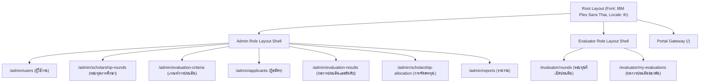

# สถาปัตยกรรม UI Layout และระบบ Sidebar (SEMS-KKU)

เอกสารสรุปการออกแบบและโครงสร้างหน้าจอส่วนติดต่อผู้ใช้ (UI Shell & Navigation) สำหรับระบบบริหารจัดการการประเมินทุนการศึกษา (SEMS-KKU) รองรับ 2 บทบาทหลักตามข้อกำหนดขอบเขตระบบ (Scope 1.3) พัฒนาด้วย **Next.js 16 (App Router)**, **TypeScript**, และ **Tailwind CSS v4**

---

## 1. ภาพรวมสถาปัตยกรรม Layout (Architecture Overview)

ระบบใช้รูปแบบ **Persistent Shell Architecture** โดยโครงสร้าง Layout (Sidebar, Header, และ Drawer) จะไม่ re-mount หรือโหลดซ้ำเมื่อผู้ใช้งานคลิกสลับเมนู

---

## 2. โครงสร้างเส้นทางและเมนูตามบทบาท (Role-based Navigation)

### 2.1 แผงควบคุมผู้ดูแลระบบ (Admin — 7 เมนูหลัก)
| เมนู | URL Path | Icon | หน้าที่ตาม Scope |
|---|---|---|---|
| **ผู้ใช้งาน** | `/admin/users` | `Users` | จัดการบัญชีผู้ใช้ สิทธิ์ และอายุการใช้งาน Evaluator (ไม่มีปุ่มลบตาม FR-USR-15) |
| **รอบทุนการศึกษา** | `/admin/scholarship-rounds` | `Calendar` | ควบคุมวงจรรอบทุน Draft → Open → Closed (ไม่มีปุ่มลบตาม FR-RND-06) |
| **เกณฑ์การประเมิน** | `/admin/evaluation-criteria` | `CheckSquare` | จัดการเกณฑ์ 100 คะแนนเต็มและเกณฑ์ย่อย |
| **ผู้สมัคร** | `/admin/applicants` | `UserCheck` | นำเข้า Excel (.xlsx) และตรวจสอบรายชื่อผู้สมัคร (ไม่แสดงเลขบัตร/เบอร์/อีเมลตาม PDPA) |
| **ผลการประเมินและอันดับ** | `/admin/evaluation-results` | `ListOrdered` | อันดับคะแนนเฉลี่ย Tie-breaker แบบเรียลไทม์ |
| **การจัดสรรทุน** | `/admin/scholarship-allocation` | `Banknote` | กำหนดงบประมาณรอบ Closed และบันทึกผลการจัดสรรรายคน |
| **รายงาน** | `/admin/reports` | `BarChart3` | ส่งออกรายงาน Excel สรุปผลประเมิน/จัดสรร พร้อมบังคับตั้งรหัสผ่าน |

### 2.2 พื้นที่ปฏิบัติงานผู้ประเมิน (Evaluator — 2 เมนูหลัก)
| เมนู | URL Path | Icon | หน้าที่ตาม Scope |
|---|---|---|---|
| **รอบทุนที่เปิดประเมิน** | `/evaluator/rounds` | `ClipboardList` | ดูรอบ Open, เลือกผู้สมัคร, กรอกคะแนนเกณฑ์ย่อยพร้อม Auto-save |
| **ผลการประเมินของฉัน** | `/evaluator/my-evaluations` | `History` | ย้อนดูประวัติคะแนนที่ตนเองประเมินแบบ Read-only (ตาม FRS ข้อ FR-EVL-14) |

> [!NOTE]
> **การปฏิบัติตามข้อห้าม Scope 1.3.5:**
> 1. ไม่มีเมนูดู Audit Log ในระบบเว็บ (FR-AUD-06)
> 2. ไม่มีปุ่มแจ้งเตือน/กระดิ่ง Notification บน Header (FR-SYS-05)
> 3. ไม่มีบทบาทนักศึกษา (Student) ในระบบ

---

## 3. ดีไซน์ซิสเต็ม: Modern Executive Slate

ธีมของระบบได้รับการออกแบบในรูปแบบ **Modern Executive Slate** เน้นความสะอาดตา สบายตา และรองรับการทำงานกับข้อมูลตารางคะแนนความหนาแน่นสูง:
* **Background Canvas:** `#F8FAFC` (`slate-50`)
* **Card & Sidebar Background:** `#FFFFFF`
* **Primary Accent:** `#2563EB` (`blue-600`) สำหรับปุ่มหลักและสถานะเน้น
* **Active Navigation Item:** `bg-blue-50/90 text-blue-700` พร้อมแถบซ้าย `border-l-4 border-blue-600`
* **Border Color:** `#E2E8F0` (`slate-200`)
* **Typography:** `IBM Plex Sans Thai` สบายตา อ่านง่าย

---

## 4. ประสบการณ์ Responsive & Micro-interactions
 
| อุปกรณ์ / ขนาดหน้าจอ | รูปแบบ Sidebar & Navigation | ประโยชน์การใช้งาน |
|---|---|---|
| **Desktop (>= 1024px)** | Sidebar เต็ม `260px` พร้อมปุ่มพับเก็บเป็น Mini Rail | ใช้งานสะดวก สามารถพับเก็บเพื่อเพิ่มพื้นที่ดูตารางได้ |
| **Tablet (768px - 1023px)** | Sidebar ปรับขนาดได้ พับเป็น Mini Rail `68px` พร้อม Hover Tooltip | คืนพื้นที่หน้าจอแนวนอนสำหรับกรอกคะแนนและตรวจทานเอกสาร |
| **Mobile (< 768px)** | Slide-over Drawer `270px` พร้อมฉากหลัง `backdrop-blur-xs` | ลื่นไหลระดับ Native App, แตะเมนูปิดอัตโนมัติ, Touch target >= 44px |

---

## 5. รูปแบบการแสดงผลข้อมูลแบบ Dual-View และ Progressive Disclosure

เพื่อรองรับการใช้งานบนข้อมูลขนาดใหญ่และชุดข้อมูลหนาแน่นสูง (Data-dense table):
* **Dual-View Pattern:** 
  - บน Desktop (`>= md`): แสดงผลด้วยตารางเต็มรูปแบบ (`table`) จัดวางคอลัมน์ชัดเจน
  - บน Mobile (`< md`): สลับไปใช้ Responsive Card View ที่แบ่งส่วนข้อมูลอย่างกะทัดรัด
* **Progressive Disclosure (คอมโพเนนต์ `RoundBadges`):**
  - เมื่อชุดเกณฑ์ถูกผูกกับหลายรอบทุน (> 2 รอบ) ระบบจะไม่แสดง Badge ยืดยาวจนตารางเสียทรง แต่จะแสดงเป็น 2 รอบสำคัญ + ป้ายสรุปกะทัดรัด `+N รอบ ▾`
  - การกดเปิดรายการทั้งหมดทำงานผ่าน **React 19 Portal (`createPortal`)** โดย Mount ตัวกล่องลอยไปยัง `document.body` เพื่อแก้ปัญหา CSS Overflow Clipping ที่มักเกิดขึ้นในตารางแบบ `overflow-x-auto` ได้ 100%
  - มี Boundary Guard ป้องกันการล้นขอบจอทั้งแกนตั้ง (สลับเปิดบน-ล่างอัตโนมัติ) และแกนนอน

---

## 6. หลักการออกแบบการเคลื่อนไหว (Motion Design: Framer Motion & Apple HIG)

1. **Spring Physics (`spring-pop`):**
   - กล่อง Popover และ Dialog ใช้การขยายตัวแบบ Overshoot สไตล์ Spring:
     `animation: spring-pop 0.28s cubic-bezier(0.175, 0.885, 0.32, 1.15)`
   - เชื่อมต่อ Transform Origin ตามทิศทางของปุ่ม Trigger (`origin-top` / `origin-bottom`) ให้ความรู้สึกผุดเด้งอย่างเป็นธรรมชาติ ไม่เลื่อนเอื่อย
2. **Tactile Feedback (`.btn-interactive`):**
   - ปุ่มและองค์ประกอบที่กดได้ (Interactive elements) มีแรงต้านทางกายภาพ `active:scale-[0.96]` เพื่อมอบ Touch Feedback คล้าย Native iOS
3. **Accessibility (ความครอบคลุมสำหรับทุกคน):**
   - ปฏิบัติตามมาตรฐาน Accessibility ด้วยการรองรับ `@media (prefers-reduced-motion: reduce)` ปิดแอนิเมชันสำหรับผู้ใช้ที่ต้องการความนิ่งของหน้าจอ
   - ขยาย Touch Targets สำหรับปุ่มบน Pagination และ Action Bar ให้มีความสูงอย่างน้อย `36px - 44px` ตามมาตรฐาน Apple HIG
