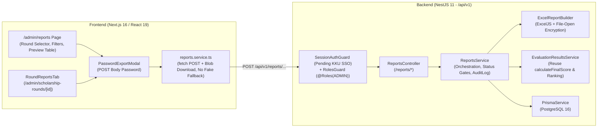

# SEMS-KKU — Reports Module Architecture

> **Status:** Planning / Architecture Design (Read-Only Analysis)  
> **Scope:** Reports & Export Module (`FR-EXP-01` – `FR-EXP-09`, `BR-EXP-01` – `BR-EXP-08`, `BR-PDP-01` – `BR-PDP-12`)

---

## 1. Executive Summary & Current State Findings

### 1.1 Existing Frontend Implementation
- **Standalone Reports Page (`frontend/src/app/(admin)/admin/reports/page.tsx`):** Currently renders `<PlaceholderPage />` with static links to `/admin/scholarship-allocation` and `/admin/evaluation-results`.
- **Round Detail Reports Tab (`frontend/src/components/rounds/round-reports-tab.tsx`):** Already implements a 2-card UI for:
  1. **Evaluation Results & Rankings Report (`RPT-EVAL-RANKINGS`)** — enabled when `roundStatus === 'CLOSED'`.
  2. **Allocation & Disbursement Report (`RPT-ALLOCATION-DISBURSE`)** — enabled when `isFinalized === true` (`AllocationStatus.FINALIZED`).
- **Password Modal (`frontend/src/components/reports/password-export-modal.tsx`):** Collects and confirms a file password (minimum 6 chars in UI; note `BR-EXP-04` specifies no complexity rule, see Unresolved Business Decisions) and includes a client-side password generator.
- **Reports Service (`frontend/src/services/reports.service.ts`):**
  - Calls non-existent endpoints `GET /api/scholarship-rounds/${roundId}/reports/evaluation-results` and `GET /api/scholarship-rounds/${roundId}/reports/allocation-disbursement` (missing `/api/v1` prefix).
  - **Security Defect (M7):** Sends `password` in the URL query string (`?password=...`).
  - **Security Defect (C1):** Sends `X-User-Id: getAdminId()`.
  - **Reliability/Integrity Defect:** Silently catches fetch/HTTP errors and generates a fake plaintext `Blob` with a `.xlsx` extension, misleading users into believing a valid encrypted Excel file was downloaded.

### 1.2 Existing Backend Implementation
- **No `ReportsModule` or `ReportsController` exists** in `backend/src/app.module.ts`.
- **ExcelJS (`exceljs@^4.4.0`)** is installed in `backend/package.json`.
- **Critical Technical Finding on ExcelJS Encryption:** Inspection of `backend/node_modules/exceljs/index.d.ts` confirms `exceljs@4.4.0` only supports **worksheet protection** (`sheet.protect(password, options)`), which locks cells against editing. It does **not** support OOXML file-open password encryption (Agile Encryption / Standard Encryption). Generating a file that cannot be opened without a password (`FR-EXP-06`) requires either an OOXML encryption library or a password-protected encrypted ZIP container (requires developer decision and dependency approval).

---

## 2. Target Architecture

### 2.1 High-Level Component Diagram

### 2.2 Backend Module Structure (`backend/src/reports/`)

| Component | Responsibility |
|---|---|
| `ReportsModule` | Imports `PrismaModule`, `EvaluationModule` (or shares `EvaluationResultsService` / `final-score.ts`), `RoundsModule` (read-only queries). Registers `ReportsController`, `ReportsService`, `ExcelReportBuilderService`. |
| `ReportsController` | Exposes `/api/v1/reports/*` endpoints. Protected by Auth Guard + `RolesGuard` (`@Roles(UserRole.ADMIN)`). Uses `@Res()` / `StreamableFile` for binary `.xlsx` responses to bypass `TransformInterceptor`. |
| `ReportsService` | Enforces business rules (`CLOSED` round for evaluation report; `FINALIZED` allocation for allocation report), queries data cleanly without side effects, computes statistics (Max, Min, Mean, SD), writes `AuditLog` (`EXPORT_EVALUATION_REPORT`, `EXPORT_ALLOCATION_REPORT`) inside a transaction or prior to streaming, and delegates workbook creation. |
| `ExcelReportBuilderService` | Builds deterministic fixed-column `.xlsx` workbooks using `ExcelJS`, applies formatting/column widths/UTF-8 Thai headers, and applies file-level encryption using the approved mechanism. |

### 2.3 Reuse of Existing Services & Logic
1. **Score & Ranking Calculation:** Reuse `calculateFinalScore` and `formatScoreDisplay` (`backend/src/evaluation/final-score.ts`) and the tie-break comparator (`average` desc -> `gpa` desc -> `studentCode` asc per `BR-SCR-05`) used in `EvaluationResultsService` (`backend/src/evaluation/evaluation-results.service.ts`).
   - *Note:* `RoundsService.getAllocationSummary` currently duplicates score calculation with an inline `.toFixed(2)` before sorting and mutates DB state on GET (`allocationSummary.create`). `ReportsService` MUST NOT call `RoundsService.getAllocationSummary`; it should query `AllocationSummary` read-only and use `calculateFinalScore`.
2. **Citizen ID Decryption:** Reuse `decryptCitizenId` (`backend/src/common/crypto.util.ts`) strictly inside `ReportsService` for the `FINALIZED` Allocation Report (`BR-EXP-06`), never in Evaluation Reports or preview endpoints.
3. **Filter Data Sources:** Reuse existing `GET /api/v1/scholarship-types` (`ScholarshipTypesController`) and `GET /api/v1/scholarship-rounds` (`RoundsController`) for frontend filter dropdowns.

### 2.4 Binary Streaming vs. `TransformInterceptor`
`backend/src/main.ts` registers a global `TransformInterceptor` that wraps return values in `{ success, statusCode, data, meta }`. For `.xlsx` export endpoints, `ReportsController` must return `StreamableFile` with `passthrough: true` (or write directly to `@Res() res: Response`) and set:
- `Content-Type: application/vnd.openxmlformats-officedocument.spreadsheetml.sheet` (or `application/zip` if encrypted ZIP is chosen)
- `Content-Disposition: attachment; filename="sems_...xlsx"`
- `Cache-Control: no-store, no-cache, must-revalidate`
- `X-Content-Type-Options: nosniff`

---

## 3. Frontend Architecture

### 3.1 `/admin/reports` Page (`frontend/src/app/(admin)/admin/reports/page.tsx`)
Replace `PlaceholderPage` with a full Reports Center supporting:
- **Filters:** Scholarship Type, Academic Year, Semester, Round Status, and Search by Round Name/ID (matching wireframes `p1_reports_no_round_selected` through `p4_reports_allocation_finalized`).
- **Round Selection & Readiness Banner:** Shows selected round's status (`DRAFT` / `OPEN` / `CLOSED`) and allocation status (`NONE` / `EDITING` / `FINALIZED`), clearly gating which exports are available.
- **Preview Table (Read-Only, PII-Safe):** Displays summary metrics and paginated applicant ranking/allocation preview without raw `citizenId`, `phone`, or `email`.
- **Export Workflow:** Opens `PasswordExportModal` -> sends `POST` request with JSON body `{ roundId, password }` -> receives binary `Blob` -> triggers browser download. On non-2xx response, displays explicit Thai error message via `ApiError` / `formatErrorMessage` with **no fake file fallback**.
