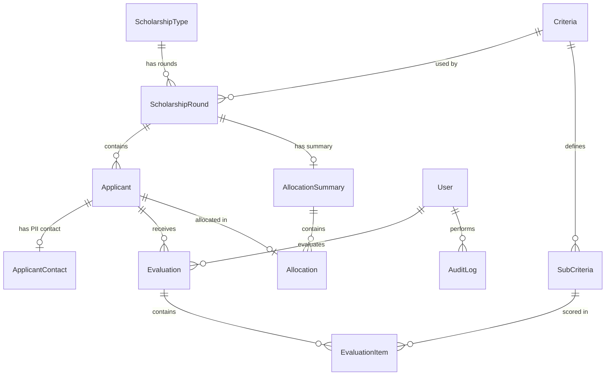

# SEMS-KKU — Reports Module Database Analysis

> **Source of Truth:** `backend/prisma/schema.prisma` (PostgreSQL 16 + Prisma 6)  
> **Constraint:** No schema or migration changes are required for the Reports Module.

---

## 1. Entity Relationships Used by Reports

---

## 2. Data Sources & Field Mapping

### 2.1 Scholarship Types & Rounds
- **`ScholarshipType` (`scholarship_types`):** `id`, `name`, `isActive`
- **`ScholarshipRound` (`scholarship_rounds`):** `id`, `name`, `academicYear`, `semester`, `scholarshipTypeId`, `criteriaId`, `status` (`DRAFT` | `OPEN` | `CLOSED`), `openedAt`, `closedAt`
- **Indexes:** `@@index([status])`, `@@index([academicYear, semester])`, `@@index([scholarshipTypeId])`, `@@index([criteriaId])`

### 2.2 Criteria & Sub-Criteria
- **`Criteria` (`criteria`):** `id`, `name`, `targetScore`
- **`SubCriteria` (`sub_criteria`):** `id`, `criteriaId`, `title`, `type` (`SCORED` | `TEXT`), `maxScore`, `allowComment`, `sortOrder`
- **Ordering:** Always sort `subCriteria` by `sortOrder ASC` (`@@index([criteriaId, sortOrder])`).

### 2.3 Applicants & PII Separation
- **`Applicant` (`applicants`):** `id`, `roundId`, `studentCode`, `titlePrefix`, `firstName`, `lastName`, `faculty`, `major`, `studyYear`, `gpa`, `anonymizedAt`
  - *Note:* `anonymizedAt` (`DateTime?`) exists for 6-year PDPA anonymization (`BR-PDP-10`). Reports should display anonymized records cleanly without crashing if `anonymizedAt != null`.
- **`ApplicantContact` (`applicant_contacts`):** `applicantId`, `phone`, `email`, `citizenIdEncrypted`, `citizenIdMasked`
  - **Evaluation Report (`BR-EXP-06`):** MUST NOT join/select `ApplicantContact`.
  - **Allocation Report (`BR-EXP-06`):** Joins `ApplicantContact` ONLY during export generation (never in preview APIs) to decrypt `citizenIdEncrypted` (AES-256-GCM) and include `phone` / `email` if required for disbursement.

### 2.4 Evaluations & Evaluation Items
- **`Evaluation` (`evaluations`):** `id`, `applicantId`, `evaluatorId`, `status` (`DRAFT` | `SUBMITTED`), `totalScore`, `submittedAt`
- **`EvaluationItem` (`evaluation_items`):** `id`, `evaluationId`, `subCriteriaId`, `score`, `comment`, `textValue`
- **`User` (`users`):** `id`, `name`, `email`, `role`
- **Critical Query Filter (`BR-SCR-01`):** Reports MUST filter `evaluations: { where: { status: EvaluationStatus.SUBMITTED } }`. `DRAFT` evaluations must NEVER be included in scores, averages, counts, or exported sheets.

### 2.5 Scholarship Allocation
- **`AllocationSummary` (`allocation_summaries`):** `id`, `roundId`, `totalBudget` (`Decimal(14,2)`), `status` (`EDITING` | `FINALIZED`), `statusChangedById`, `statusChangedAt`
- **`Allocation` (`allocations`):** `id`, `summaryId`, `applicantId`, `isAwarded` (`Boolean`), `amount` (`Decimal(14,2)`)
- **Decimal Handling:** Prisma returns `Decimal` objects for `gpa` (`Decimal(3,2)`), `totalBudget`, and `amount` (`Decimal(14,2)`). Convert explicitly via `Number(...)` for calculations and format with 2 decimal places (`0.00`) in Excel.

### 2.6 Audit Logs
- **`AuditLog` (`audit_logs`):** `id` (`BigInt`), `actorId`, `action` (`AuditAction`), `entityType`, `entityId`, `roundId`, `oldValue`, `newValue`, `detail`, `createdAt`
- **Existing Enum Values:** `AuditAction.EXPORT_EVALUATION_REPORT` and `AuditAction.EXPORT_ALLOCATION_REPORT` are already defined in `backend/prisma/schema.prisma` (lines 38-39).
- **Important:** `detail` JSON MUST NEVER contain the export `password`, decrypted `citizenId`, or raw PII (`NFR-PRV-02`). Only store safe metadata such as `{ roundId, roundName, totalApplicants, exportedAt }`.

---

## 3. Query Performance & N+1 Prevention

- Use targeted `select` projections rather than `include: { contact: true }` when contact data is not needed.
- For Evaluation Reports with per-evaluator sub-criteria breakdown, fetch:
  1. Round + Criteria + SubCriteria (`orderBy: { sortOrder: 'asc' }`) in 1 query.
  2. Applicants for `roundId` with `evaluations` (`where: { status: 'SUBMITTED' }`, selecting `evaluator: { select: { id, name } }` and `items`).
- Do **not** execute per-applicant queries in a loop (prevents N+1).
- Use `prisma.$transaction` or write `AuditLog` before streaming the Excel buffer so failed audit writes abort the export (`FR-EXP-09`).
